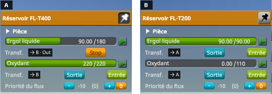
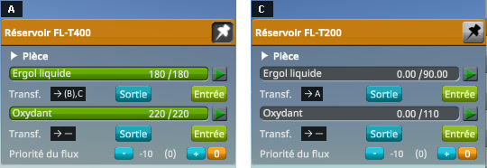

# Resource Transfer Fix

**⚠️ Work in progress.** This is an active investigation, not a finished mod. The figures, the code and the conclusions on this page can still change, and several questions are still open — they are listed in [Work in progress](#work-in-progress).

A fix for stock KSP 1.12, kept as small as possible: two Harmony patches, in two short source files. It is a
mod of its own, built and measured on top of
[KSP Community Fixes](https://github.com/KSPModdingLibs/KSPCommunityFixes), the base most players run.
Here is what it fixes:

> **The In, Out and Stop buttons of a resource transfer, in the part action windows, do not always do
> what they say.** A tank that has filled another one keeps showing Stop although nothing leaves it any
> more. And once the window of a tank holding liquid fuel only has been opened, the oxidizer buttons of
> the next tank do nothing at all.

**How this was made.** The investigation and the code were written with Claude, Anthropic's AI
assistant. Everything here was reviewed and validated by a human — me — who enjoyed learning along the
way how the part action windows of KSP pair tanks for a transfer. I am saying so up front, because
contributions made with an AI deserve a closer look than others, and because some people would rather
stop reading here. That look is what this page is built for: every figure on it is read on the game's
screen or in this mod's log, the protocols that produce them are played by a public script on a stock
install, the stock code quoted here is a handful of lines anyone can check, and the fix is two short files
you can read in one sitting.

## Why stuck transfers matter

Refuelling a ship from a tanker or a station means moving fuel tank by tank: open the window of a tank
of the tanker and pin it, open the window of a tank of the ship, press In on the ship's tank (or Out on
the tanker's), wait until it is full, then open the next tank of the ship, and so on. On stock, two things
go wrong on the way.

The first is harmless but confusing: once the ship's tank is full, the tanker's tank still shows Stop,
as if it were still sending, until it is empty or Stop is pressed. Its In and Out buttons stay hidden
meanwhile.

The second costs time and patience: when the ship has tanks of liquid fuel only, for nuclear engines, next
to tanks of liquid fuel and oxidizer, opening one of the former and then one of the latter leaves the
oxidizer buttons of both windows unpaired. Pressing In or Out on them does nothing; the liquid fuel still
moves. Closing the windows and opening them again pairs them again.

 

*KSP 1.12.5 without this mod, with [KSP Community Fixes](https://github.com/KSPModdingLibs/KSPCommunityFixes),
in French (Sortie is Out, Entrée is In, Ergol liquide is liquid fuel, Oxydant oxidizer), with
[KSP Diag - Resource Transfer](https://github.com/lhervier/KSP-Diag-ResourceTransfer), whose letters mark
the windows and whose badges, on each transfer row, give the letters of the windows the row is paired with
(`—`: none). Two windows cropped from the screenshots of each protocol. Left, the
[filling protocol](docs/checking-the-culprit-filling.md#the-protocol): ten seconds after the FL-T200 on the
right was filled from the FL-T400 on the left. Right, the
[liquid-fuel-only protocol](docs/checking-the-culprit-fuel-only.md#the-protocol): five seconds after In
was pressed for the oxidizer of the FL-T200, once the window of a Mk1 Liquid Fuel Fuselage had been
opened.*

## The culprit: two mistakes in the way windows pair their transfers

Every part action window shows, for each resource that can be transferred, a transfer control with In,
Out and Stop buttons. A control is paired with the controls of the same resource in the other open
windows: pressing In makes it take from them, Out makes it send to them. The tank that takes does the
moving, frame after frame.

**When a transfer stops.** `UIPartActionResourceTransfer.UpdateItem` stops a tank that sends only when
that tank is empty, never when the tanks it sends to are full. And it keeps a tank that takes going for as
long as any tank it is paired with is busy, sending or taking alike: two tanks filled from a third keep
each other going once the third is empty.

**How controls are paired.** `UIPartActionController.SetupResourceTransfer` pairs a new control with the
controls of a list that `UIPartActionController.UpdateActiveWindows` empties every time it runs,
once per frame. A control built again after the list has been emptied, while the others were listed
before, is paired with none. The window of a tank of liquid fuel only takes the oxidizer controls out of
every window, and the next tank's window brings them back on either side of that emptying: the tanker's
oxidizer control and the new tank's are then paired with nothing.

**→ Full chapter: [The culprit](docs/the-culprit.md)**

## The fix: stop what no longer flows, pair with every open window

Two patches, each with its own switch in [Settings](#settings), both on by default. Nothing is saved in
any of them; removing the mod gives the stock behaviour back at once.

- **`stopIdleTransfers`.** After stock has updated a transfer control, the mod stops it if none of the
  shown controls it is paired with does the other half: a tank that sends stops when no tank takes from
  it, a tank that takes stops when no tank sends to it.
- **`linkAllTransfers`.** When stock pairs a new control, the mod first pairs it with every control of the
  same resource, on another part, that an open window shows, and drops from their pairs the controls that
  have been destroyed. Stock then runs as usual, and adds no pair twice.

**→ Full chapter: [The fix](docs/the-fix.md)**

## Checked: filling a tank

A tanker's FL-T400 fills an empty FL-T200 through their part action windows, then the windows are watched
for ten seconds. On stock, the FL-T400 shows Stop throughout, with 90 units of liquid fuel left; with this
mod, it shows In and Out again as soon as the FL-T200 is full, and the mod's log says it stopped it.

**→ Full chapter: [Checking the culprit: filling a tank](docs/checking-the-culprit-filling.md)**

## Checked: a tank of liquid fuel only

With the tanker's window pinned, the windows of a Mk1 Liquid Fuel Fuselage and then of an empty FL-T200 are
opened, and In is pressed for the FL-T200's oxidizer. On stock, five seconds later, no oxidizer has moved;
with this mod, 27.61 units have, and the mod's log says it paired the tanker's oxidizer control.

**→ Full chapter: [Checking the culprit: a tank of liquid fuel only](docs/checking-the-culprit-fuel-only.md)**

## Checked: several tanks

A full tank sends to two empty ones until it runs dry, then two full tanks send to an empty one until it is
full. On stock, the tanks that did not run dry or fill up keep showing Stop; with this mod, every tank stops
when the transfer ends, and the amounts moved are the same.

**→ Full chapter: [Checking several tanks](docs/checking-several-tanks.md)**

## Checked: other resources

Liquid fuel, monopropellant, xenon and ore, each moved from a tanker to a ship across two Clamp-O-Tron
Docking Ports joined in the editor. On stock, every resource moves, and every time the tanker keeps showing Stop once the
ship's tank is full; with this mod, the tanker stops with it, and the amounts moved are the same.

**→ Full chapter: [Checking other resources](docs/checking-other-resources.md)**

## Checked: transfers that obey crossfeed

In a game where transfers obey crossfeed, the crossfeed of a docking port between a tanker and a ship is
closed, then opened again. On stock as with this mod, the transfer buttons leave both windows, then come
back paired and work; with this mod, the tanker also stops once the ship's tank is full.

**→ Full chapter: [Checking transfers that obey crossfeed](docs/checking-crossfeed.md)**

## Checked: vessels docked in flight

Two rovers are undocked, then driven back into each other until their Clamp-O-Tron Docking Ports dock, and
liquid fuel is moved from one to the other. On stock, the transfer runs, and the tanker keeps showing Stop
once the ship's tank is full; with this mod, it stops with it.

**→ Full chapter: [Checking vessels docked in flight](docs/checking-docking.md)**

## Checked: a tank's contents switched in flight

With the windows of a tanker and of an empty FL-T200 open, the FL-T200 is switched in flight with
B9PartSwitch to liquid fuel only, and In is pressed for its liquid fuel. On stock, the switch leaves the
transfer controls of both windows unpaired, and nothing moves; with this mod, they come back paired, and the
liquid fuel moves until the tanker is out of it.

**→ Full chapter: [Checking a tank's contents switched in flight](docs/checking-in-flight-switch.md)**

## Work in progress

Both patches act on every resource transfer of every part action window. Each point below is a place
where this mod changes what stock does, and so where it could break something, or a stock problem it does
not fix yet. What you would see, and how to check it by hand:

- **Transfer buttons that do nothing during time warp.** Under on-rails time warp, the In, Out and Stop
  buttons stay in the part action windows, but a click on them does nothing:
  `UIPartActionResourceTransfer.OnBtnIn`, `OnBtnOut` and `OnBtnStop` ignore the click while the controls of
  the vessel are locked, and `TimeWarp.setRate` locks them for on-rails warp, not for physics warp. A
  transfer started before the warp goes on flowing. Nothing tells the buttons are dead: the player presses
  Out, nothing moves, and the transfer looks broken. A third patch, with a setting of its own, will grey the
  three buttons out while a click on them would be ignored, and give them back when the warp ends. Greyed
  out rather than hidden, Stop still shows that a transfer flows during the warp. It will leave them alone
  when KSP loses the focus: KSP locks every control then, and stops updating the windows anyway. Read in
  the stock code, not played yet: with two tank windows open, start on-rails warp and press Out; do the
  same under physics warp; and start a transfer before warping, then press Stop during the warp.
- **RealFuels' tanks changed in flight.** RealFuels (the tanks of RP-1) has a tank's part action window
  built again when its tanks change, as B9PartSwitch does in
  [Checked: a tank's contents switched in flight](#checked-a-tanks-contents-switched-in-flight). Read in its
  source, not played: with two tank windows open, change one tank's contents in flight, and press In or Out
  on it, without this mod and with it.
- **Mods that change part action windows, or move resources their own way.** A mod that adds, removes or
  rebuilds the items of a part action window could pair controls in its own way. None was tried. Kerbal
  Attachment System moves resources between two vessels linked by its pipe in a window of its own
  (`KASLinkResourceConnector`), without the transfer controls of the part action windows: this mod leaves
  it alone. Once the pipe docks the two vessels into one, that window sends the player to the stock
  transfer, the one this mod fixes. That is read in its source, not played: link two vessels with a KAS
  pipe, move fuel through its window, dock them through the pipe, and move fuel with the part action
  windows, without this mod and with it. AlternateResourcePanel, likewise, has In and Out buttons of its own,
  in windows of its own, and moves the resources itself: this mod leaves them alone.

## Install

Copy the `GameData\KSPFixResourceTransfer` folder into the `GameData` folder of KSP. It needs
[Harmony](https://github.com/KSPModdingLibs/HarmonyKSP), as KSP Community Fixes does.

## Settings

`GameData\KSPFixResourceTransfer\PluginData\settings.cfg` is read once, when KSP starts:

```
// Stops a resource transfer once nothing flows through it any more.
stopIdleTransfers = True

// Pairs every transfer of a part action window with the transfers of the same resource in the other
// open windows.
linkAllTransfers = True

// How much the mod writes to KSP.log: Error, Warning, Info or Debug.
logLevel = Info
```

- Either patch can be turned off on its own: with `False`, that part of the transfer behaves as on stock.
- At `Debug`, the mod writes one line to `KSP.log` for every transfer it stops, and for every pairing it
  adds that stock does not make at that point.

## Build

Set `KSPDIR` to the folder of a KSP install with Harmony in its `GameData`, then run `build.bat`: it
compiles `GameData\KSPFixResourceTransfer\KSPFixResourceTransfer.dll`. Installing is up to you.

## License

[MIT](LICENSE).
