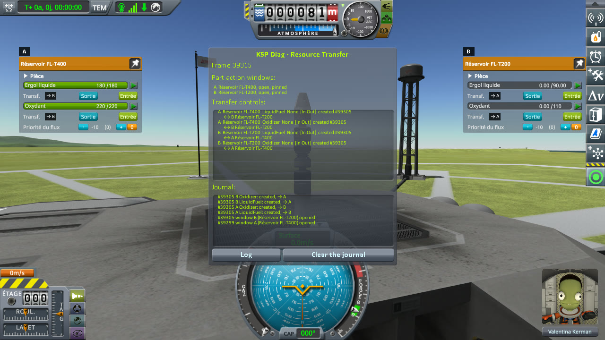
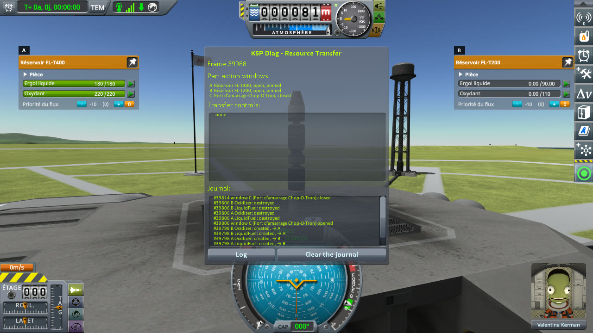
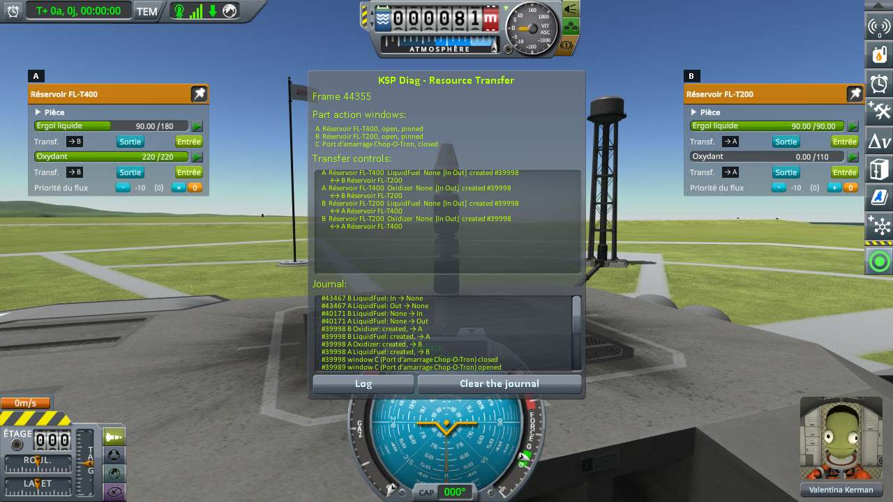

# Checking transfers that obey crossfeed

Part of [Resource Transfer Fix](../README.md). In a game whose transfers obey crossfeed, the crossfeed of a
docking port between a tanker and a ship is closed, then opened again. Do the transfer buttons leave the
windows and come back, and do they work once back? Played without this mod, then with it.

## The install

The same as for [filling a tank](checking-the-culprit-filling.md#the-install): KSP 1.12.5 with KSP
Community Fixes 1.41.1, in French (*Sortie* is Out, *Entrée* is In, *Ergol liquide* is liquid fuel,
*Oxydant* oxidizer), with Resource Transfer Fix 0.1.0 at `Debug` for *With this mod*, and
[KSP Diag - Resource Transfer](https://github.com/lhervier/KSP-Diag-ResourceTransfer) in both.

## The protocol

The save is [transfer-crossfeed-kerbin.sfs](../diag/transfer-crossfeed-kerbin.sfs): the rocket of
[Checking other resources](checking-other-resources.md#the-protocol), the ship above two Clamp-O-Tron
Docking Ports joined face to face, the tanker below, in a sandbox game where the advanced difficulty setting
*Resource transfer obeys crossfeed rules* is on (it is on in the Moderate and Hard presets). Copy the save
into the folder of a sandbox game, and load it.

1. Right-click the tanker's FL-T400 (full) to open its part action window, and pin it; the same for the
   ship's FL-T200 (empty).
2. Right-click the tanker's docking port, press *Disable Crossfeed* in its window, and right-click empty
   space: the port's window, the only one not pinned, closes.
3. The same, with *Enable Crossfeed*.
4. In the FL-T200's window, press In under its liquid fuel.
5. Wait until the FL-T200 is full, then five seconds more, and note the buttons of both tanks.

**Played by a script.** [run-transfers.py](../diag/automation/run-transfers.py), with
`--protocol crossfeed`. It presses the port's buttons by the names of their events (`DisableXFeed`,
`EnableXFeed`), the same in every language of the game, and takes a screenshot after steps 1, 2, 3 and 5.

## On stock

Read off the screenshots below, the liquid fuel of both tanks and the transfer buttons under it (the
FL-T400's window is A, the FL-T200's B):

| Step | FL-T400 (A) | its buttons | FL-T200 (B) | its buttons |
|---|---|---|---|---|
| Both windows open | 180 / 180 | In, Out | 0 / 90 | In, Out |
| Crossfeed disabled | 180 / 180 | **none** | 0 / 90 | **none** |
| Crossfeed enabled again | 180 / 180 | In, Out | 0 / 90 | In, Out |
| FL-T200 full | 90 / 180 | **Stop** | 90 / 90 | In, Out |

With the crossfeed closed, neither window shows a transfer row. With it open again, both rows are back,
paired (badges `→ B` and `→ A`), and In moves the liquid fuel; once the FL-T200 is full, the FL-T400 keeps
showing Stop, as in [filling a tank](checking-the-culprit-filling.md).

<p class="thumbs"><a href="../imgs/checking-crossfeed/stock/1-crossfeed-on.jpg"></a> <a href="../imgs/checking-crossfeed/stock/2-crossfeed-off.jpg"></a> <a href="../imgs/checking-crossfeed/stock/3-crossfeed-on-again.jpg"></a> <a href="../imgs/checking-crossfeed/stock/4-tank-full.jpg"></a></p>

<details>
<summary>The four screenshots, on stock</summary>

Both windows open:


Crossfeed disabled:


Crossfeed enabled again:


The FL-T200 full:


</details>

## With this mod

Read off the screenshots below:

| Step | FL-T400 (A) | its buttons | FL-T200 (B) | its buttons |
|---|---|---|---|---|
| Both windows open | 180 / 180 | In, Out | 0 / 90 | In, Out |
| Crossfeed disabled | 180 / 180 | **none** | 0 / 90 | **none** |
| Crossfeed enabled again | 180 / 180 | In, Out | 0 / 90 | In, Out |
| FL-T200 full | 90 / 180 | **In, Out** | 90 / 90 | In, Out |

The buttons leave and come back as on stock; the FL-T400 stops with the FL-T200.

<p class="thumbs"><a href="../imgs/checking-crossfeed/fix/1-crossfeed-on.jpg"></a> <a href="../imgs/checking-crossfeed/fix/2-crossfeed-off.jpg"></a> <a href="../imgs/checking-crossfeed/fix/3-crossfeed-on-again.jpg"></a> <a href="../imgs/checking-crossfeed/fix/4-tank-full.jpg"></a></p>

<details>
<summary>The four screenshots, with this mod</summary>

Both windows open:


Crossfeed disabled:


Crossfeed enabled again:


The FL-T200 full:


</details>

### What the logs say

The journal of KSP Diag - Resource Transfer, on stock ([`KSP.log`](../diag/crossfeed/stock/KSP.log)). The
transfer controls leave as soon as the port's window opens: a window open on a part without the resource
is enough. With the crossfeed disabled, they do not come back when that window closes; with it enabled,
they come back together, paired, when it closes:

```
[KSPDiagResourceTransfer] #39316 window C (Port d'amarrage Chop-O-Tron) opened
[KSPDiagResourceTransfer] #39316 A LiquidFuel: destroyed
[KSPDiagResourceTransfer] #39316 A Oxidizer: destroyed
[KSPDiagResourceTransfer] #39316 B LiquidFuel: destroyed
[KSPDiagResourceTransfer] #39316 B Oxidizer: destroyed
[KSPDiagResourceTransfer] #39322 window C (Port d'amarrage Chop-O-Tron) closed
[KSPDiagResourceTransfer] #39526 window C (Port d'amarrage Chop-O-Tron) opened
[KSPDiagResourceTransfer] #39532 window C (Port d'amarrage Chop-O-Tron) closed
[KSPDiagResourceTransfer] #39532 A LiquidFuel: created, → B
[KSPDiagResourceTransfer] #39532 A Oxidizer: created, → B
[KSPDiagResourceTransfer] #39532 B LiquidFuel: created, → A
[KSPDiagResourceTransfer] #39532 B Oxidizer: created, → A
[KSPDiagResourceTransfer] #39703 A LiquidFuel: None → Out
[KSPDiagResourceTransfer] #39703 B LiquidFuel: None → In
[KSPDiagResourceTransfer] #43058 B LiquidFuel: In → None
```

With this mod ([`KSP.log`](../diag/crossfeed/fix/KSP.log)), the same until the end, where both stop:

```
[KSPDiagResourceTransfer] #40171 A LiquidFuel: None → Out
[KSPDiagResourceTransfer] #40171 B LiquidFuel: None → In
[KSPDiagResourceTransfer] #43467 A LiquidFuel: Out → None
[KSPDiagResourceTransfer] #43467 B LiquidFuel: In → None
```

The mod adds no pairing here, and writes one line, when the FL-T200 is full:

```
[KSPFixResourceTransfer] [DEBUG] Stopped the LiquidFuel transfer out of fuelTank 1000009: no tank takes from it any more
```

## What the measurements say

With transfers that obey crossfeed, closing the crossfeed of a docking port takes the transfer buttons away
from both sides, and opening it brings them back paired, on stock as with this mod. The mod changes nothing
in that; it only stops the tanker once the ship's tank is full.
