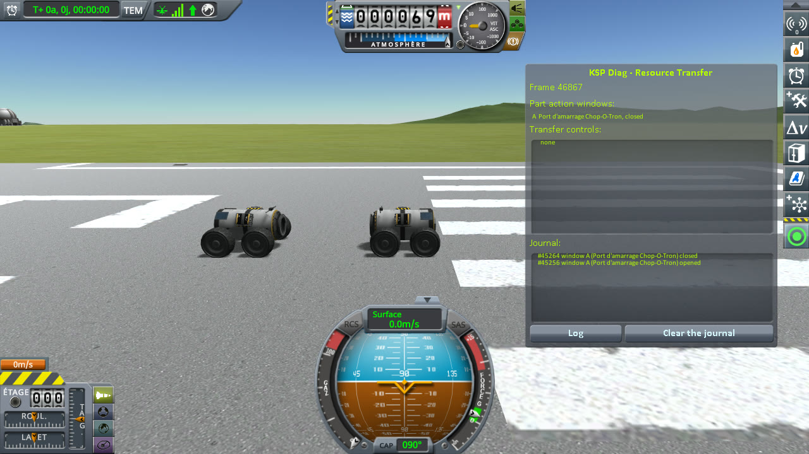
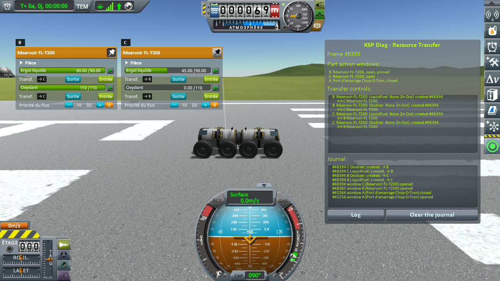
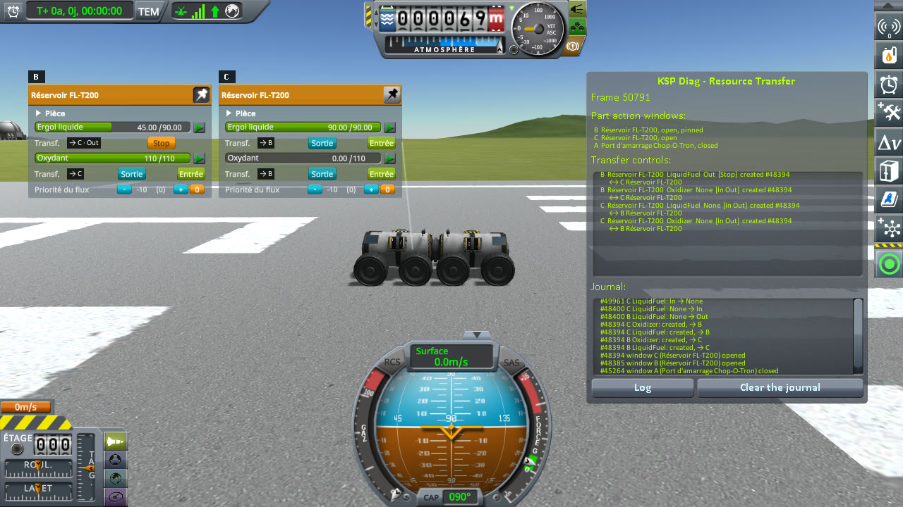
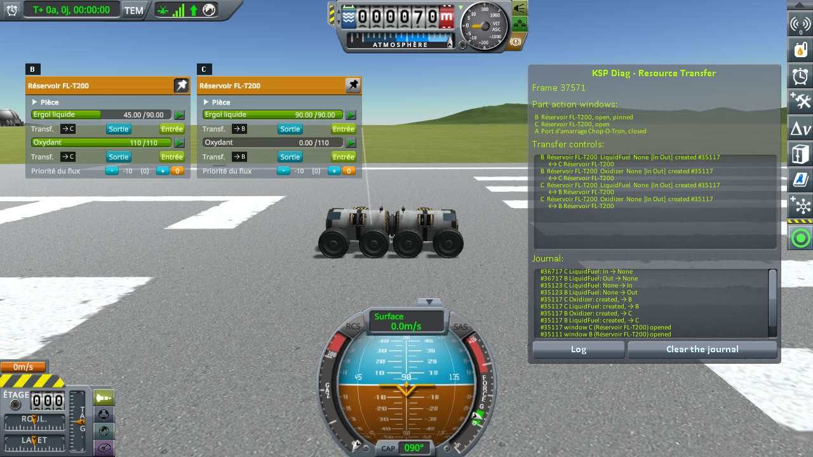

# Checking vessels docked in flight

Part of [Resource Transfer Fix](../README.md). Two rovers, a "tanker" and a "ship", are undocked, then
docked again by driving one into the other, and liquid fuel is moved from the tanker to the ship. Does the
transfer run, and does the tanker stop once the ship's tank is full? Played without this mod, then with it.

## The install

The same as for [filling a tank](checking-the-culprit-filling.md#the-install): KSP 1.12.5 with KSP
Community Fixes 1.41.1, in French (*Sortie* is Out, *Entrée* is In, *Ergol liquide* is liquid fuel,
*Oxydant* oxidizer, *Désamarrer* Undock), with Resource Transfer Fix 0.1.0 at `Debug` for *With this mod*,
and [KSP Diag - Resource Transfer](https://github.com/lhervier/KSP-Diag-ResourceTransfer) in both.

## The protocol

The save is [transfer-docking-kerbin.sfs](../diag/transfer-docking-kerbin.sfs): a sandbox game with two
small rovers on the runway, docked nose to nose by their Clamp-O-Tron Docking Ports. Each has two FL-T200
tanks, four TR-2L Ruggedized Vehicular Wheels and a Probodobodyne OKTO2 probe core. The tanker, the active
vessel, has both its tanks full (90 units of liquid fuel each); the ship's front tank holds 45 units of
liquid fuel out of 90, its rear tank is empty. Copy the save into the folder of a sandbox game, and load it.

1. Right-click the tanker's docking port, press *Undock* in its window, and right-click empty space to close
   it. The two rovers are now two vessels.
2. Back the tanker away about three metres, then drive it slowly forward on the same heading until the ports
   dock: KSP writes `Docking to vessel Transfer Docking` in `KSP.log`.
3. Right-click the tanker's front FL-T200 to open its part action window, and pin it; then right-click the
   ship's front FL-T200.
4. In the ship's tank's window, press In under its liquid fuel.
5. Wait until the ship's tank is full, then five seconds more, and note the buttons of both tanks.

**Played by a script.** [run-transfers.py](../diag/automation/run-transfers.py), with
`--protocol docking`. It presses *Undock* by the name of its event, the same in every language of the game,
drives the tanker three metres back at 0.5 m/s, then 3.6 metres forward at 0.2 m/s, and takes a screenshot
after the tanker has backed away, after step 3 and after step 5.

## On stock

Read off the screenshots below, the liquid fuel of both tanks and the transfer buttons under it (the
tanker's tank's window is B, the ship's C; window A was the docking port's):

| Step | Tanker's FL-T200 (B) | its buttons | Ship's FL-T200 (C) | its buttons |
|---|---|---|---|---|
| Docked again, both windows open | 90 / 90 | In, Out | 45 / 90 | In, Out |
| Ship's tank full | 45 / 90 | **Stop** | 90 / 90 | In, Out |

Once docked again, the two windows are paired (badges `→ C` and `→ B`), and In moves the liquid fuel. Once
the ship's tank is full, the tanker keeps showing Stop, with half of its liquid fuel left, as in
[filling a tank](checking-the-culprit-filling.md).

<p class="thumbs"><a href="../imgs/checking-docking/stock/1-undocked.jpg"></a> <a href="../imgs/checking-docking/stock/2-docked-again.jpg"></a> <a href="../imgs/checking-docking/stock/3-tank-full.jpg"></a></p>

<details>
<summary>The three screenshots, on stock</summary>

The tanker, in the middle, backed away from the ship:


Docked again, both windows open:


The ship's tank full:


</details>

## With this mod

Read off the screenshots below:

| Step | Tanker's FL-T200 (B) | its buttons | Ship's FL-T200 (C) | its buttons |
|---|---|---|---|---|
| Docked again, both windows open | 90 / 90 | In, Out | 45 / 90 | In, Out |
| Ship's tank full | 45 / 90 | **In, Out** | 90 / 90 | In, Out |

The same amounts move; the tanker stops with the ship's tank.

<p class="thumbs"><a href="../imgs/checking-docking/fix/1-undocked.jpg"></a> <a href="../imgs/checking-docking/fix/2-docked-again.jpg"></a> <a href="../imgs/checking-docking/fix/3-tank-full.jpg"></a></p>

<details>
<summary>The three screenshots, with this mod</summary>

The tanker, in the middle, backed away from the ship:


Docked again, both windows open:


The ship's tank full:


</details>

### What the logs say

In both logs, KSP writes `Docking to vessel Transfer Docking` when the ports dock again. The journal of KSP
Diag - Resource Transfer, on stock ([`KSP.log`](../diag/docking/stock/KSP.log)): the two windows open on the
docked rovers, their controls are created paired, and only the ship's stops:

```
[KSPDiagResourceTransfer] #48385 window B (Réservoir FL-T200) opened
[KSPDiagResourceTransfer] #48394 window C (Réservoir FL-T200) opened
[KSPDiagResourceTransfer] #48394 B LiquidFuel: created, → C
[KSPDiagResourceTransfer] #48394 B Oxidizer: created, → C
[KSPDiagResourceTransfer] #48394 C LiquidFuel: created, → B
[KSPDiagResourceTransfer] #48394 C Oxidizer: created, → B
[KSPDiagResourceTransfer] #48400 B LiquidFuel: None → Out
[KSPDiagResourceTransfer] #48400 C LiquidFuel: None → In
[KSPDiagResourceTransfer] #49961 C LiquidFuel: In → None
```

With this mod ([`KSP.log`](../diag/docking/fix/KSP.log)), the same until the end, where both stop:

```
[KSPDiagResourceTransfer] #35123 B LiquidFuel: None → Out
[KSPDiagResourceTransfer] #35123 C LiquidFuel: None → In
[KSPDiagResourceTransfer] #36717 B LiquidFuel: Out → None
[KSPDiagResourceTransfer] #36717 C LiquidFuel: In → None
```

The mod adds no pairing here, and writes one line, when the ship's tank is full:

```
[KSPFixResourceTransfer] [DEBUG] Stopped the LiquidFuel transfer out of fuelTankSmall 3809551786: no tank takes from it any more
```

## What the measurements say

Two vessels docked in flight pair their transfer controls as the parts of one vessel do, on stock as with
this mod. The mod changes nothing in that; it only stops the tanker once the ship's tank is full.
