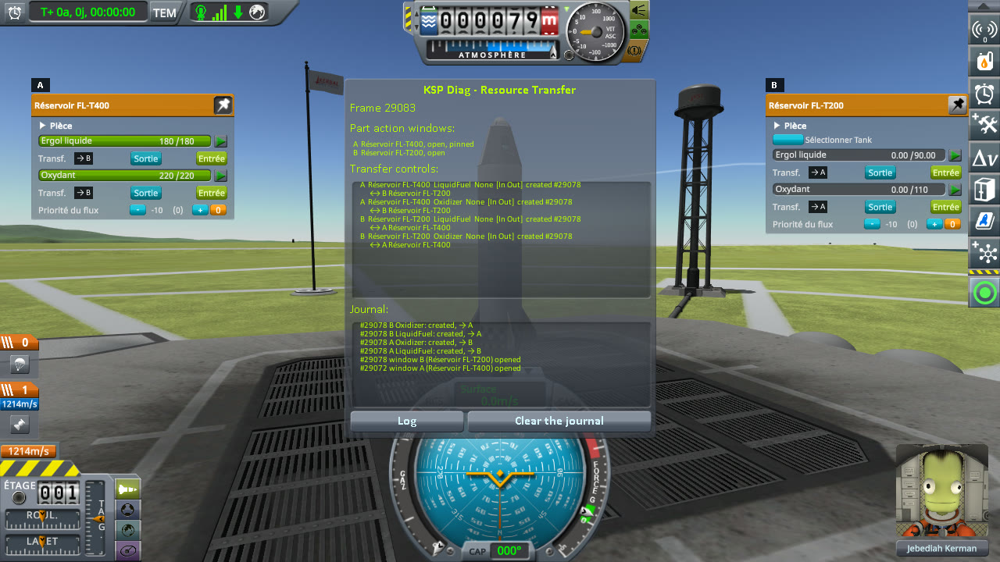
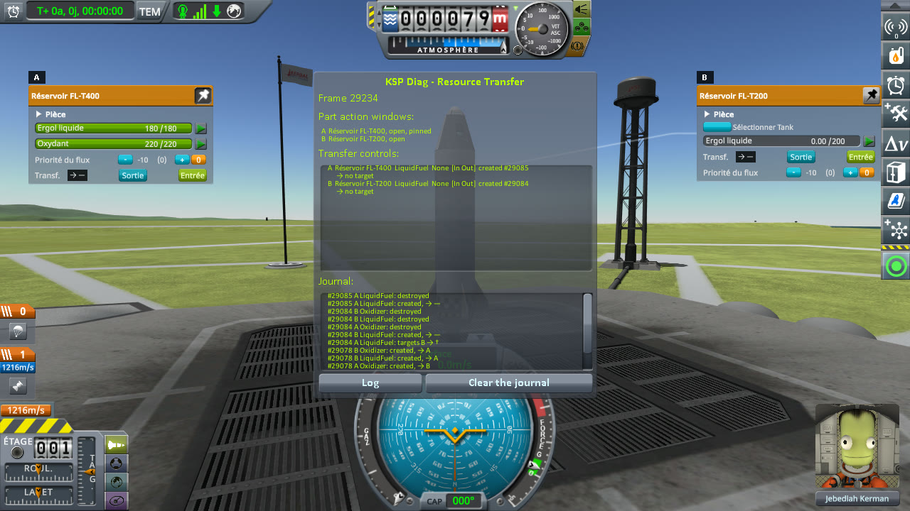
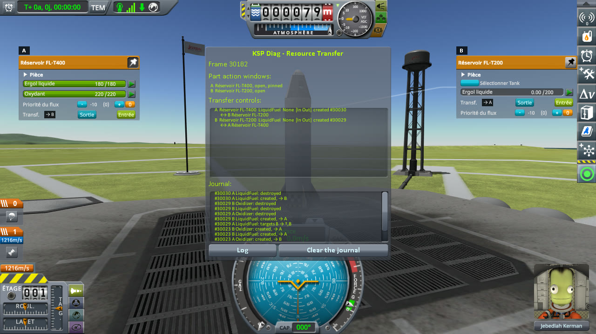
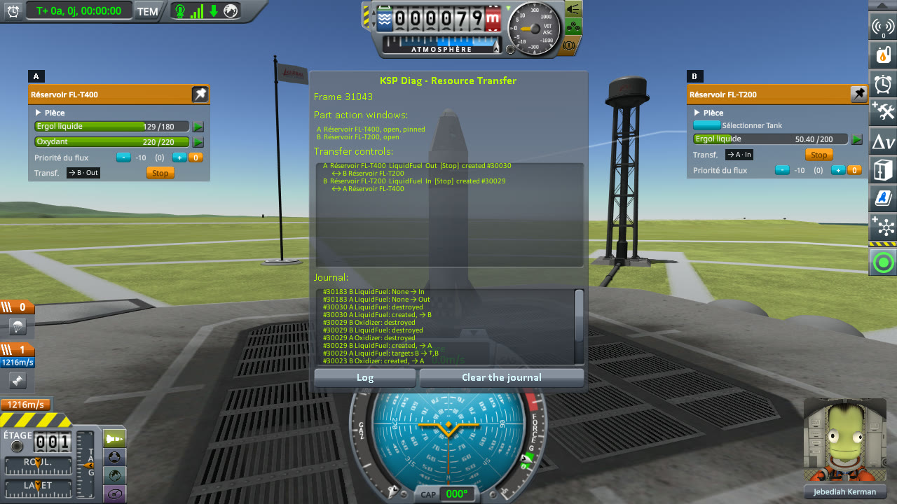
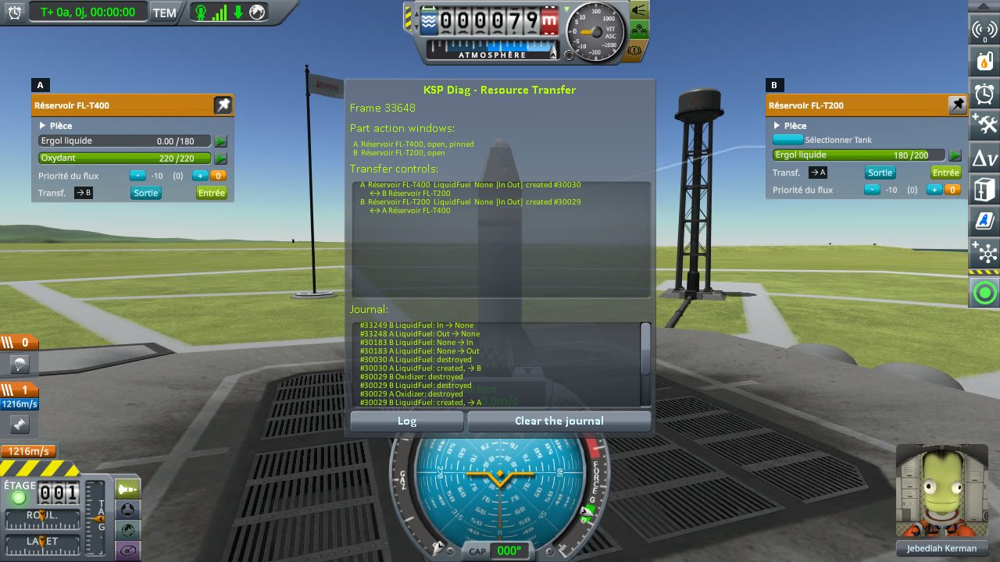

# Checking a tank's contents switched in flight

Part of [Resource Transfer Fix](../README.md). With the windows of a tanker and of an empty tank open and
paired, the empty tank's contents are switched in flight with B9PartSwitch, from liquid fuel and oxidizer to
liquid fuel only, and In is pressed for its liquid fuel. Are the two tanks still paired, and does the
transfer run? Played without this mod, then with it.

## The install

The same as for [filling a tank](checking-the-culprit-filling.md#the-install): KSP 1.12.5 with KSP
Community Fixes 1.41.1, in French (*Sortie* is Out, *Entrée* is In, *Ergol liquide* is liquid fuel,
*Oxydant* oxidizer, *Sélectionner Tank* B9PartSwitch's Select Tank), with Resource Transfer Fix 0.1.0 at
`Debug` for *With this mod*, and [KSP Diag - Resource Transfer](https://github.com/lhervier/KSP-Diag-ResourceTransfer)
in both. Plus, in both:

- [B9PartSwitch](https://github.com/KSPModStewards/B9PartSwitch) 2.21.0.4;
- a test patch for ModuleManager,
  [ResourceTransferB9Test](../diag/in-flight-switch/ResourceTransferB9Test/fuelTankSmall-switch.cfg), to
  copy into `GameData` as the `ResourceTransferB9Test` folder. It gives the FL-T200 a B9PartSwitch switch
  that works in flight, between two tank types of B9PartSwitch: LFO (90 units of liquid fuel and 110 of
  oxidizer, as stock has it) and LiquidFuel (200 units of liquid fuel). Stock parts have no such switch,
  and the mods that give them one do not always allow it in flight: the patch makes the case without any
  other mod.

## The protocol

The save is [transfer-kerbin.sfs](../diag/transfer-kerbin.sfs), the one of
[filling a tank](checking-the-culprit-filling.md#the-protocol): a sandbox game with one rocket on the launch
pad, whose FL-T400 tank, full, plays the tanker, and whose FL-T200 tank is empty. With the test patch, the
FL-T200 loads as LFO. Copy the save into the folder of a sandbox game, and load it.

1. Right-click the FL-T400 to open its part action window, and pin it; then right-click the FL-T200.
2. In the FL-T200's window, press *Select Tank*, and pick LiquidFuel in the dialog that opens.
3. In the FL-T200's window, press In under its liquid fuel.
4. Wait five seconds, and note the liquid fuel of both tanks; then wait until the FL-T400 has no liquid fuel
   left, thirty seconds at most, and note it again, with the buttons of both tanks.

**Played by a script.** [run-transfers.py](../diag/automation/run-transfers.py), with
`--protocol in-flight-switch`. For step 2, it calls `ModuleB9PartSwitch.SwitchSubtype` with `LiquidFuel`,
which is what the LiquidFuel button of that dialog calls. It takes a screenshot after steps 1 and 2, and the
two of step 4.

## On stock

Read off the screenshots below, the liquid fuel of both tanks, the transfer buttons under it, and the
badges of KSP Diag - Resource Transfer (the FL-T400's window is A, the FL-T200's B):

| Step | FL-T400 (A) | its badge | FL-T200 (B) | its badge |
|---|---|---|---|---|
| Both windows open | 180 / 180 | `→ B` | 0 / 90 | `→ A` |
| FL-T200 switched to LiquidFuel | 180 / 180 | **`→ —`** | 0 / 200 | **`→ —`** |
| Five seconds after In | 180 / 180 | `→ —` | **0 / 200** | `→ —` |
| Thirty seconds later | 180 / 180 | `→ —` | **0 / 200** | `→ —` |

Once the FL-T200 is switched, its oxidizer is gone, and so are the oxidizer buttons of both windows. The
liquid fuel controls of both windows are built again, paired with nothing: In does nothing, and both tanks
keep showing In and Out.

<p class="thumbs"><a href="../imgs/checking-in-flight-switch/stock/1-before.jpg"></a> <a href="../imgs/checking-in-flight-switch/stock/2-switched.jpg"></a> <a href="../imgs/checking-in-flight-switch/stock/3-five-seconds-later.jpg"></a> <a href="../imgs/checking-in-flight-switch/stock/4-end.jpg"></a></p>

<details>
<summary>The four screenshots, on stock</summary>

Both windows open:


The FL-T200 switched to LiquidFuel:


Five seconds after In:


Thirty seconds later:


</details>

## With this mod

Read off the screenshots below:

| Step | FL-T400 (A) | its badge | FL-T200 (B) | its badge |
|---|---|---|---|---|
| Both windows open | 180 / 180 | `→ B` | 0 / 90 | `→ A` |
| FL-T200 switched to LiquidFuel | 180 / 180 | **`→ B`** | 0 / 200 | **`→ A`** |
| Five seconds after In | 129 / 180 | `→ B · Out` | **50.40 / 200** | `→ A · In` |
| FL-T400 out of liquid fuel | 0.00 / 180 | `→ B` | **180 / 200** | `→ A` |

The liquid fuel controls are built again as on stock, but paired: In moves the liquid fuel, and once the
FL-T400 is out of it, both tanks show In and Out again.

<p class="thumbs"><a href="../imgs/checking-in-flight-switch/fix/1-before.jpg"></a> <a href="../imgs/checking-in-flight-switch/fix/2-switched.jpg"></a> <a href="../imgs/checking-in-flight-switch/fix/3-five-seconds-later.jpg"></a> <a href="../imgs/checking-in-flight-switch/fix/4-end.jpg"></a></p>

<details>
<summary>The four screenshots, with this mod</summary>

Both windows open:


The FL-T200 switched to LiquidFuel:


Five seconds after In:


The FL-T400 out of liquid fuel:


</details>

### What the logs say

The journal of KSP Diag - Resource Transfer, on stock ([`KSP.log`](../diag/in-flight-switch/stock/KSP.log)).
The two windows open paired. When the FL-T200 is switched, B9PartSwitch empties its window and has it built
again: its new liquid fuel control is paired with nothing, while the FL-T400's control is left paired with
the one just destroyed (`†`). That dead pair makes stock build the FL-T400's control again, paired with
nothing either. Pressing In changes no state:

```
[KSPDiagResourceTransfer] #29078 window B (Réservoir FL-T200) opened
[KSPDiagResourceTransfer] #29078 A LiquidFuel: created, → B
[KSPDiagResourceTransfer] #29078 A Oxidizer: created, → B
[KSPDiagResourceTransfer] #29078 B LiquidFuel: created, → A
[KSPDiagResourceTransfer] #29078 B Oxidizer: created, → A
[KSPDiagResourceTransfer] #29084 A LiquidFuel: targets B → †
[KSPDiagResourceTransfer] #29084 B LiquidFuel: created, → —
[KSPDiagResourceTransfer] #29084 A Oxidizer: destroyed
[KSPDiagResourceTransfer] #29084 B LiquidFuel: destroyed
[KSPDiagResourceTransfer] #29084 B Oxidizer: destroyed
[KSPDiagResourceTransfer] #29085 A LiquidFuel: created, → —
[KSPDiagResourceTransfer] #29085 A LiquidFuel: destroyed
```

With this mod ([`KSP.log`](../diag/in-flight-switch/fix/KSP.log)), the same controls are built again, on the
same frames, but each new one is paired with the other window, and the transfer runs until the FL-T400 is
out of liquid fuel:

```
[KSPDiagResourceTransfer] #30029 A LiquidFuel: targets B → †,B
[KSPDiagResourceTransfer] #30029 B LiquidFuel: created, → A
[KSPDiagResourceTransfer] #30029 A Oxidizer: destroyed
[KSPDiagResourceTransfer] #30029 B LiquidFuel: destroyed
[KSPDiagResourceTransfer] #30029 B Oxidizer: destroyed
[KSPDiagResourceTransfer] #30030 A LiquidFuel: created, → B
[KSPDiagResourceTransfer] #30030 A LiquidFuel: destroyed
[KSPDiagResourceTransfer] #30183 A LiquidFuel: None → Out
[KSPDiagResourceTransfer] #30183 B LiquidFuel: None → In
[KSPDiagResourceTransfer] #33248 A LiquidFuel: Out → None
[KSPDiagResourceTransfer] #33249 B LiquidFuel: In → None
```

The mod's lines: it pairs the FL-T200's new control, then, when the FL-T400's is built again, drops the
destroyed control from the FL-T200's pairs and pairs the two:

```
[KSPFixResourceTransfer] [DEBUG] Linked the LiquidFuel transfer of fuelTankSmall 649418999 with 1 tank(s) stock does not link it with here, 1 in all
[KSPFixResourceTransfer] [DEBUG] Dropped 1 destroyed control(s) from the LiquidFuel transfer of fuelTankSmall 649418999
[KSPFixResourceTransfer] [DEBUG] Linked the LiquidFuel transfer of fuelTank 1223746542 with 1 tank(s) stock does not link it with here, 1 in all
```

## What the measurements say

Switching a tank's contents in flight builds the transfer controls of the open windows again, and stock
leaves them unpaired: In and Out do nothing. With this mod, they come back paired, and the transfer runs.
