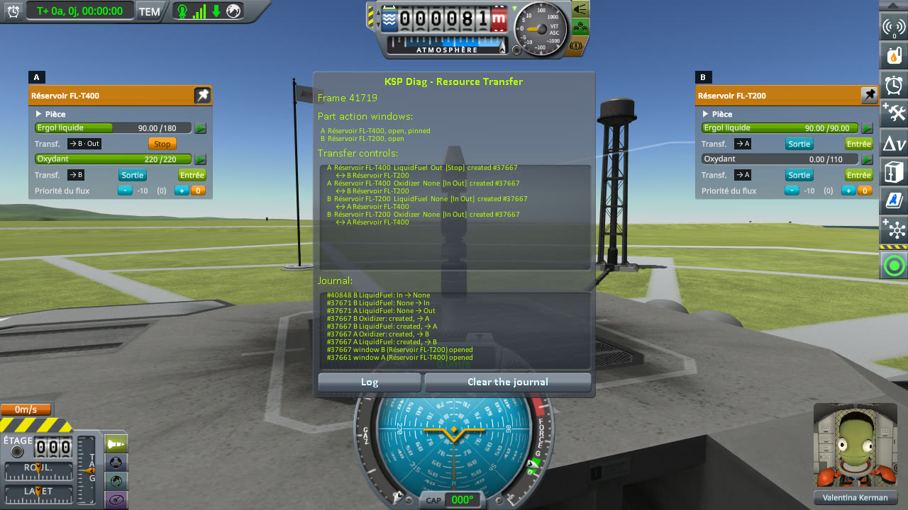
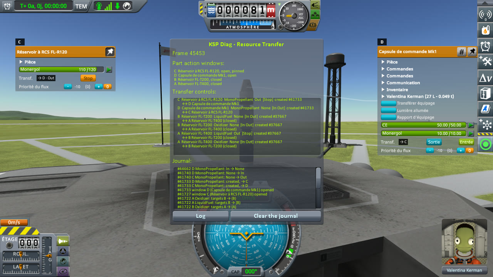
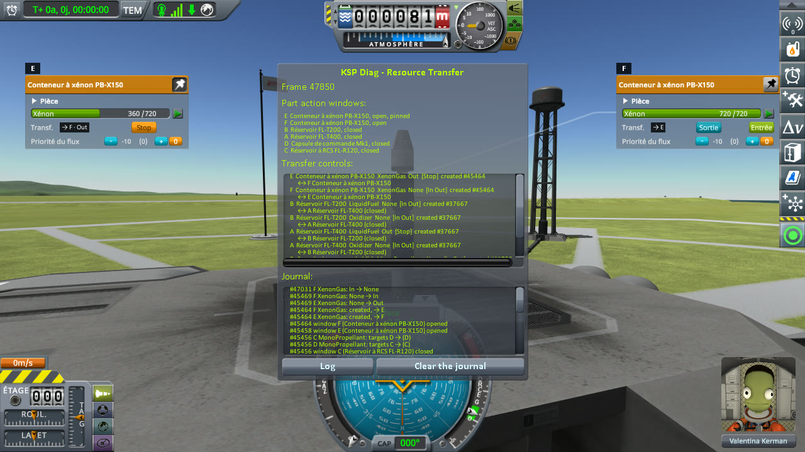
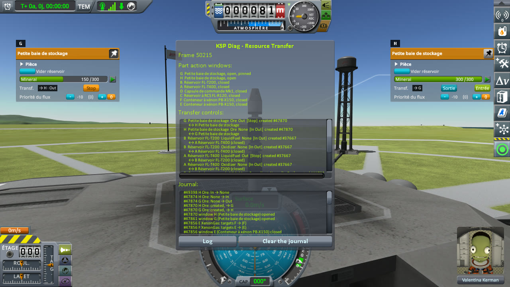
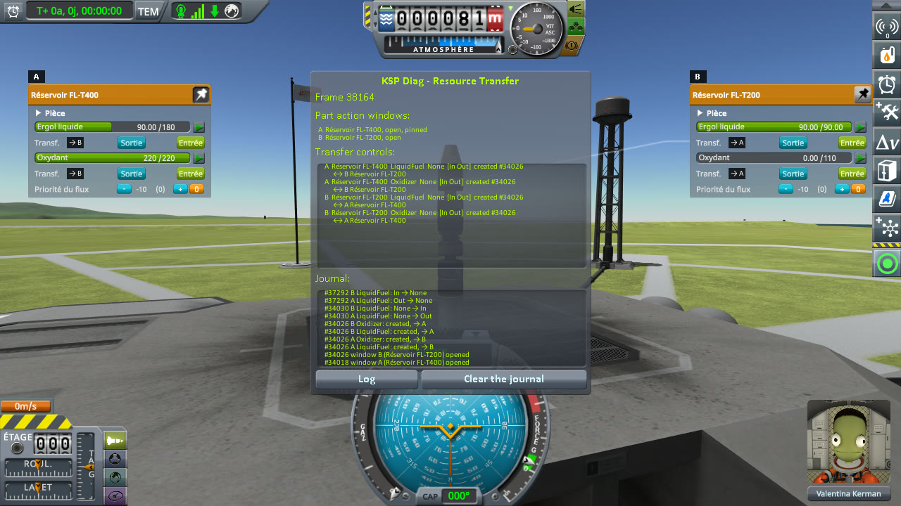
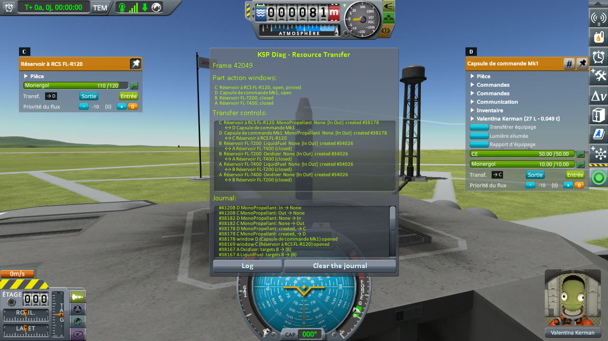
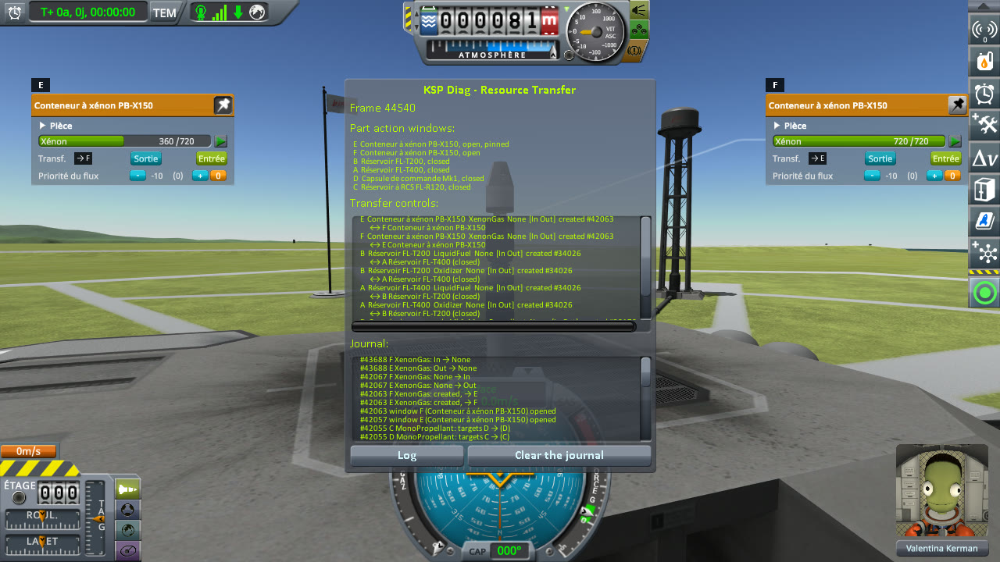
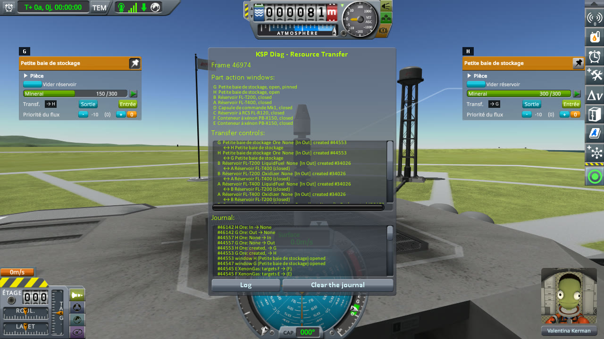

# Checking other resources

Part of [Resource Transfer Fix](../README.md). Liquid fuel, monopropellant, xenon and ore, each moved from a
"tanker" to a "ship" across two docking ports. Does each transfer run, and does the tanker stop once the
ship's tank is full? Played without this mod, then with it.

## The install

The same as for [filling a tank](checking-the-culprit-filling.md#the-install): KSP 1.12.5 with KSP
Community Fixes 1.41.1, in French (*Sortie* is Out, *Entrée* is In, *Ergol liquide* is liquid fuel,
*Monergol* monopropellant, *Xénon* xenon, *Minerai* ore), with Resource Transfer Fix 0.1.0 at `Debug` for
*With this mod*, and [KSP Diag - Resource Transfer](https://github.com/lhervier/KSP-Diag-ResourceTransfer)
in both.

## The protocol

The save is [transfer-resources-kerbin.sfs](../diag/transfer-resources-kerbin.sfs): a sandbox game with a
rocket of its own on the launch pad, two Clamp-O-Tron Docking Ports joined face to face in its middle,
as they are joined in the editor. Above them, the "ship": a Mk1 pod with no monopropellant (10 units at most),
an FL-T200 tank, empty, a PB-X150 xenon container holding 360 units out of 720, and a Small Holding Tank
holding 150 units of ore out of 300. Below them, the "tanker", every tank full: an FL-R120 monopropellant
tank (120), a PB-X150 (720), a Small Holding Tank (300) and an FL-T400 (180 units of liquid fuel). Copy
the save into the folder of a sandbox game, and load it.

For each resource in turn, liquid fuel, monopropellant, xenon, then ore:

1. Right-click the tanker's tank to open its part action window, and pin it.
2. Right-click the ship's tank to open its window.
3. In the ship's tank's window, press In under the resource.
4. Wait until the ship's tank is full, then five seconds more, and note the buttons of both tanks.
5. Unpin the tanker's window, and right-click empty space to close both windows.

Every ship's tank holds less room than its tanker holds of the resource: the tanker is never empty when
the ship's tank is full.

**Played by a script.** [run-transfers.py](../diag/automation/run-transfers.py), with
`--protocol other-resources`, as for the other protocols: the tanker's window to the left, the ship's to the
right, a screenshot at each step 4.

## On stock

Read off the screenshots below, the resource of both tanks at step 4, and the buttons under it (the letters
are those of KSP Diag - Resource Transfer):

| Resource | Tanker's tank | its buttons | Ship's tank | its buttons |
|---|---|---|---|---|
| Liquid fuel | FL-T400 (A), 90 / 180 | **Stop** | FL-T200 (B), 90 / 90 | In, Out |
| Monopropellant | FL-R120 (C), 110 / 120 | **Stop** | Mk1 pod (D), 10 / 10 | In, Out |
| Xenon | PB-X150 (E), 360 / 720 | **Stop** | PB-X150 (F), 720 / 720 | In, Out |
| Ore | Small Holding Tank (G), 150 / 300 | **Stop** | Small Holding Tank (H), 300 / 300 | In, Out |

Every resource moved across the docking ports, and every time the tanker kept showing Stop once the ship's
tank was full, its badge on `· Out`.

<p class="thumbs"><a href="../imgs/checking-other-resources/stock/1-LiquidFuel.jpg"></a> <a href="../imgs/checking-other-resources/stock/2-MonoPropellant.jpg"></a> <a href="../imgs/checking-other-resources/stock/3-XenonGas.jpg"></a> <a href="../imgs/checking-other-resources/stock/4-Ore.jpg"></a></p>

<details>
<summary>The four screenshots, on stock</summary>

Liquid fuel:


Monopropellant:


Xenon:


Ore:


</details>

## With this mod

Read off the screenshots below:

| Resource | Tanker's tank | its buttons | Ship's tank | its buttons |
|---|---|---|---|---|
| Liquid fuel | FL-T400 (A), 90 / 180 | **In, Out** | FL-T200 (B), 90 / 90 | In, Out |
| Monopropellant | FL-R120 (C), 110 / 120 | **In, Out** | Mk1 pod (D), 10 / 10 | In, Out |
| Xenon | PB-X150 (E), 360 / 720 | **In, Out** | PB-X150 (F), 720 / 720 | In, Out |
| Ore | Small Holding Tank (G), 150 / 300 | **In, Out** | Small Holding Tank (H), 300 / 300 | In, Out |

The same amounts moved, and every tanker stopped with the ship's tank.

<p class="thumbs"><a href="../imgs/checking-other-resources/fix/1-LiquidFuel.jpg"></a> <a href="../imgs/checking-other-resources/fix/2-MonoPropellant.jpg"></a> <a href="../imgs/checking-other-resources/fix/3-XenonGas.jpg"></a> <a href="../imgs/checking-other-resources/fix/4-Ore.jpg"></a></p>

<details>
<summary>The four screenshots, with this mod</summary>

Liquid fuel:


Monopropellant:


Xenon:


Ore:


</details>

### What the logs say

The journal of KSP Diag - Resource Transfer, on stock
([`KSP.log`](../diag/other-resources/stock/KSP.log)): for each resource, only the ship's tank goes back to
`None`.

```
[KSPDiagResourceTransfer] #37671 A LiquidFuel: None → Out
[KSPDiagResourceTransfer] #37671 B LiquidFuel: None → In
[KSPDiagResourceTransfer] #40848 B LiquidFuel: In → None
[KSPDiagResourceTransfer] #41740 C MonoPropellant: None → Out
[KSPDiagResourceTransfer] #41740 D MonoPropellant: None → In
[KSPDiagResourceTransfer] #44662 D MonoPropellant: In → None
[KSPDiagResourceTransfer] #45469 E XenonGas: None → Out
[KSPDiagResourceTransfer] #45469 F XenonGas: None → In
[KSPDiagResourceTransfer] #47031 F XenonGas: In → None
[KSPDiagResourceTransfer] #47874 G Ore: None → Out
[KSPDiagResourceTransfer] #47874 H Ore: None → In
[KSPDiagResourceTransfer] #49398 H Ore: In → None
```

With this mod ([`KSP.log`](../diag/other-resources/fix/KSP.log)), both tanks on the same frame:

```
[KSPDiagResourceTransfer] #34030 A LiquidFuel: None → Out
[KSPDiagResourceTransfer] #34030 B LiquidFuel: None → In
[KSPDiagResourceTransfer] #37292 A LiquidFuel: Out → None
[KSPDiagResourceTransfer] #37292 B LiquidFuel: In → None
[KSPDiagResourceTransfer] #38182 C MonoPropellant: None → Out
[KSPDiagResourceTransfer] #38182 D MonoPropellant: None → In
[KSPDiagResourceTransfer] #41208 C MonoPropellant: Out → None
[KSPDiagResourceTransfer] #41208 D MonoPropellant: In → None
[KSPDiagResourceTransfer] #42067 E XenonGas: None → Out
[KSPDiagResourceTransfer] #42067 F XenonGas: None → In
[KSPDiagResourceTransfer] #43688 E XenonGas: Out → None
[KSPDiagResourceTransfer] #43688 F XenonGas: In → None
[KSPDiagResourceTransfer] #44557 G Ore: None → Out
[KSPDiagResourceTransfer] #44557 H Ore: None → In
[KSPDiagResourceTransfer] #46142 G Ore: Out → None
[KSPDiagResourceTransfer] #46142 H Ore: In → None
```

And the mod says it stopped each tanker:

```
[KSPFixResourceTransfer] [DEBUG] Stopped the LiquidFuel transfer out of fuelTank 1000009: no tank takes from it any more
[KSPFixResourceTransfer] [DEBUG] Stopped the MonoPropellant transfer out of RCSFuelTank 1000006: no tank takes from it any more
[KSPFixResourceTransfer] [DEBUG] Stopped the XenonGas transfer out of xenonTank 1000007: no tank takes from it any more
[KSPFixResourceTransfer] [DEBUG] Stopped the Ore transfer out of SmallTank 1000008: no tank takes from it any more
```

## What the measurements say

Monopropellant, xenon and ore go through the same transfer controls as liquid fuel, across docking ports
as well, and stock leaves the tanker on Stop for each of them. With this mod, the tanker stops with the
ship's tank, whatever the resource, and the amounts moved are those of stock.
