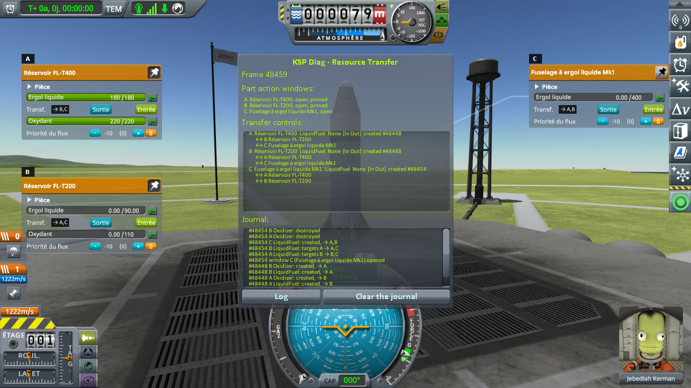
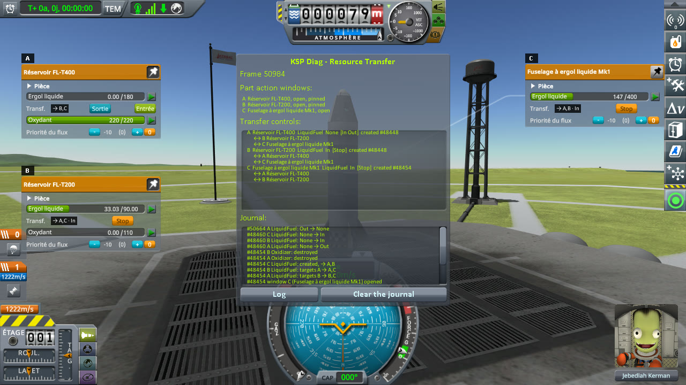
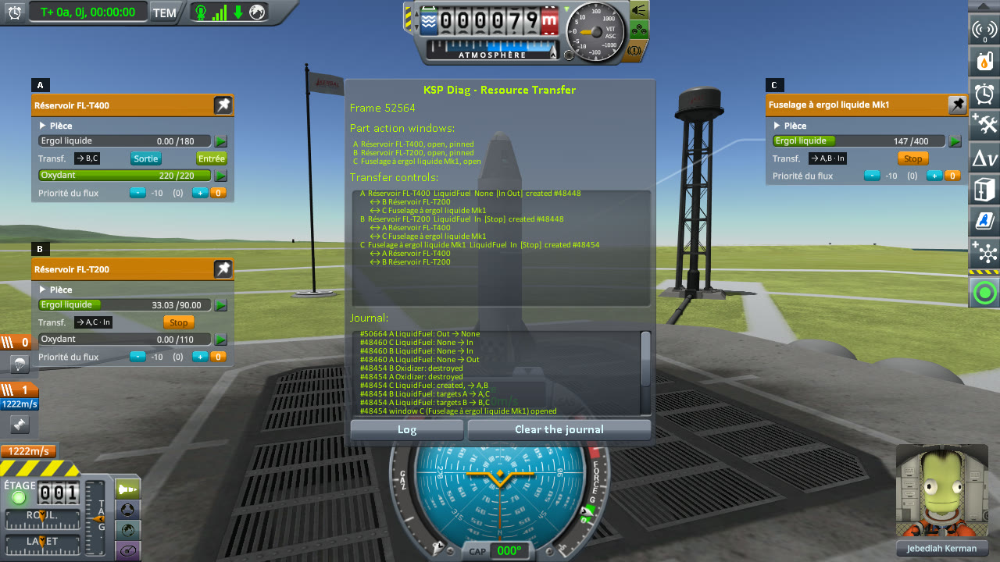
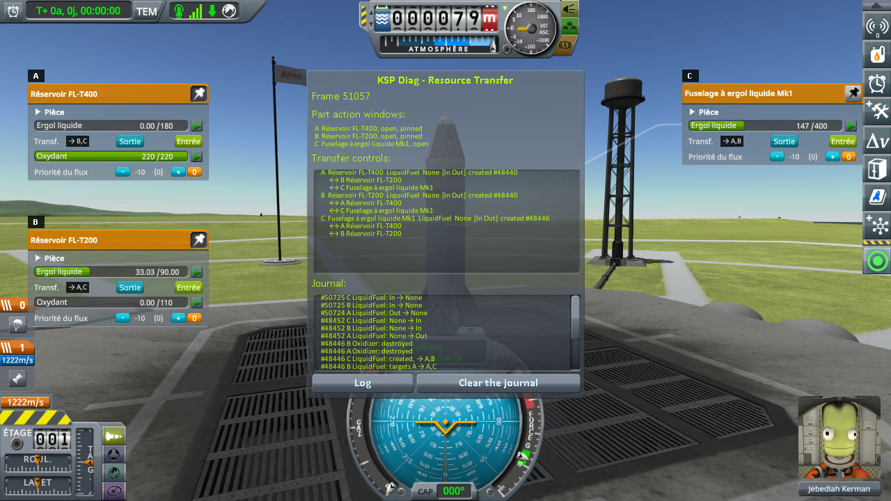
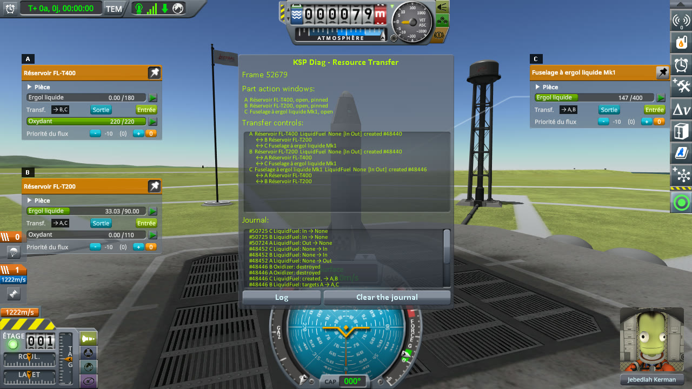
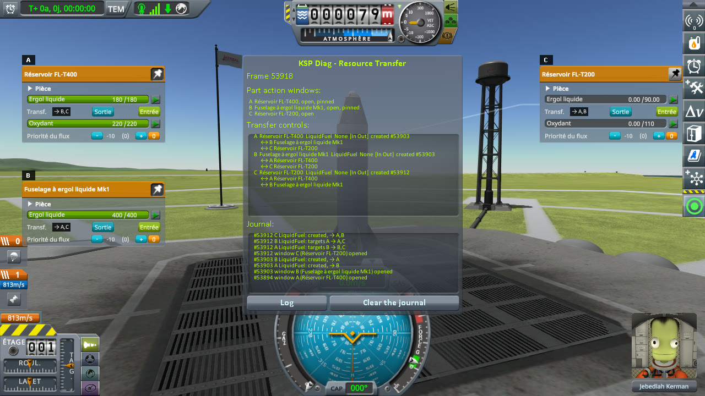
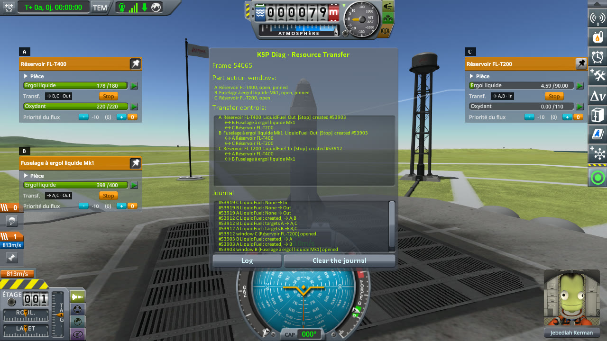
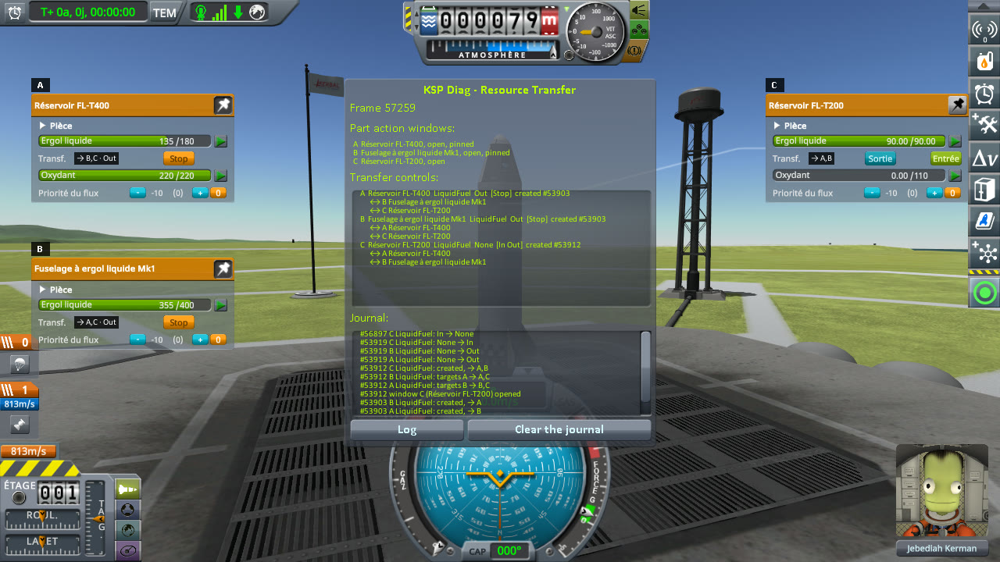
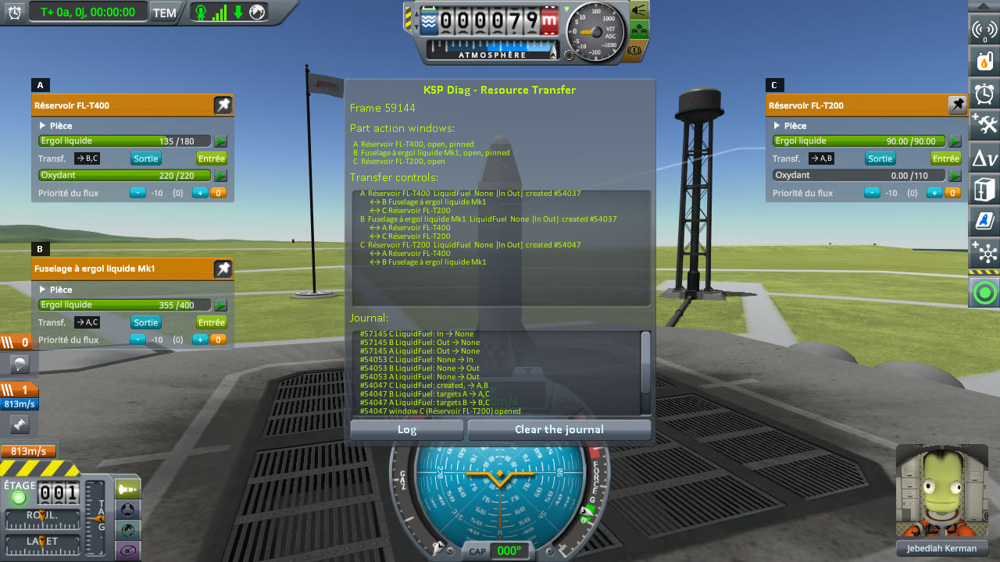

# Checking several tanks

Part of [Resource Transfer Fix](../README.md). A transfer between more than two tanks: one tank sending to
two, then two tanks sending to one. Does every tank stop when the transfer ends, and none before? Played
without this mod, then with it.

## The install

The same as for [filling a tank](checking-the-culprit-filling.md#the-install): KSP 1.12.5 with KSP
Community Fixes 1.41.1, in French (*Sortie* is Out, *Entrée* is In, *Ergol liquide* is liquid fuel), with
Resource Transfer Fix 0.1.0 at `Debug` for *With this mod*, and
[KSP Diag - Resource Transfer](https://github.com/lhervier/KSP-Diag-ResourceTransfer) in both: its letters
mark the windows, and its badge on each transfer row gives the letters of the windows the row is paired
with, followed by `· Out` or `· In` while it sends or takes.

## One tank to several: the protocol

The save is [transfer-kerbin.sfs](../diag/transfer-kerbin.sfs), the rocket of the other protocols: an
FL-T400 tank, full (180 units of liquid fuel); an FL-T200 tank, empty (90 units at most); a Mk1 Liquid Fuel
Fuselage, empty (400 units at most). Copy the save into the folder of a sandbox game, and load it.

1. Right-click the FL-T400 to open its part action window, and pin it.
2. Right-click the FL-T200 to open its window, and pin it.
3. Right-click the fuselage to open its window.
4. In the FL-T400's window, press Out under its liquid fuel.
5. Wait until the FL-T400 is empty, then two seconds more, and note the buttons of the three tanks.
6. Wait ten seconds, and note them again.

The FL-T400 holds less than the two others can take: it runs dry before either is full.

**Played by a script.** [run-transfers.py](../diag/automation/run-transfers.py), with
`--protocol one-to-several`. It drags the two pinned windows to the left of the screen, one under the
other, and the fuselage's to the right; it takes a screenshot before step 4, one second after it, at step 5
and at step 6.

## One tank to several: on stock

Read off the screenshots below, the liquid fuel of the three tanks and the buttons under it (the FL-T400's
window is A, the FL-T200's B, the fuselage's C):

| Step | FL-T400 (A) | its buttons | FL-T200 (B) | its buttons | fuselage (C) | its buttons |
|---|---|---|---|---|---|---|
| Before Out | 180 / 180 | In, Out | 0 / 90 | In, Out | 0 / 400 | In, Out |
| One second after Out | 167 / 180 | Stop | 2.30 / 90 | Stop | 10.20 / 400 | Stop |
| FL-T400 empty | 0 / 180 | In, Out | 33.03 / 90 | **Stop** | 147 / 400 | **Stop** |
| Ten seconds later | 0 / 180 | In, Out | 33.03 / 90 | **Stop** | 147 / 400 | **Stop** |

The FL-T400 stopped once empty. The FL-T200 and the fuselage kept taking, as far as their controls are
concerned (badges `→ A,C · In` and `→ A,B · In`), with nothing left to take.

<p class="thumbs"><a href="../imgs/checking-several-tanks/one-to-several/stock/1-before.jpg"></a> <a href="../imgs/checking-several-tanks/one-to-several/stock/2-sending.jpg"></a> <a href="../imgs/checking-several-tanks/one-to-several/stock/3-tanker-empty.jpg"></a> <a href="../imgs/checking-several-tanks/one-to-several/stock/4-ten-seconds-later.jpg"></a></p>

<details>
<summary>The four screenshots, on stock</summary>

Before Out:


One second after Out:


The FL-T400 empty:


Ten seconds later:


</details>

## One tank to several: with this mod

Read off the screenshots below:

| Step | FL-T400 (A) | its buttons | FL-T200 (B) | its buttons | fuselage (C) | its buttons |
|---|---|---|---|---|---|---|
| Before Out | 180 / 180 | In, Out | 0 / 90 | In, Out | 0 / 400 | In, Out |
| One second after Out | 167 / 180 | Stop | 2.34 / 90 | Stop | 10.40 / 400 | Stop |
| FL-T400 empty | 0 / 180 | In, Out | 33.03 / 90 | **In, Out** | 147 / 400 | **In, Out** |
| Ten seconds later | 0 / 180 | In, Out | 33.03 / 90 | **In, Out** | 147 / 400 | **In, Out** |

The same amounts moved; the three tanks stopped together when the FL-T400 ran dry.

<p class="thumbs"><a href="../imgs/checking-several-tanks/one-to-several/fix/1-before.jpg"></a> <a href="../imgs/checking-several-tanks/one-to-several/fix/2-sending.jpg"></a> <a href="../imgs/checking-several-tanks/one-to-several/fix/3-tanker-empty.jpg"></a> <a href="../imgs/checking-several-tanks/one-to-several/fix/4-ten-seconds-later.jpg"></a></p>

<details>
<summary>The four screenshots, with this mod</summary>

Before Out:


One second after Out:


The FL-T400 empty:


Ten seconds later:


</details>

### What the logs say

The journal of KSP Diag - Resource Transfer, on stock ([`KSP.log`](../diag/stock/KSP.log)): the FL-T400 (A)
goes back to `None` once empty, the two others never do.

```
[KSPDiagResourceTransfer] #48460 A LiquidFuel: None → Out
[KSPDiagResourceTransfer] #48460 B LiquidFuel: None → In
[KSPDiagResourceTransfer] #48460 C LiquidFuel: None → In
[KSPDiagResourceTransfer] #50664 A LiquidFuel: Out → None
```

With this mod ([`KSP.log`](../diag/fix/KSP.log)), the two others go back to `None` on the frame after:

```
[KSPDiagResourceTransfer] #48452 A LiquidFuel: None → Out
[KSPDiagResourceTransfer] #48452 B LiquidFuel: None → In
[KSPDiagResourceTransfer] #48452 C LiquidFuel: None → In
[KSPDiagResourceTransfer] #50724 A LiquidFuel: Out → None
[KSPDiagResourceTransfer] #50725 B LiquidFuel: In → None
[KSPDiagResourceTransfer] #50725 C LiquidFuel: In → None
```

The mod writes one line for this, for the fuselage:

```
[KSPFixResourceTransfer] [DEBUG] Stopped the LiquidFuel transfer into MK1Fuselage 649418893: no tank sends to it any more
```

Once the fuselage is back to `None`, the FL-T200 has no target left that is busy, and stock stops it in
the same update: the mod has nothing to do for it.

## Several tanks to one: the protocol

The save is [transfer-kerbin-two-full.sfs](../diag/transfer-kerbin-two-full.sfs): the same rocket, with
the fuselage full (400 units). Copy the save into the folder of a sandbox game, and load it.

1. Right-click the FL-T400 to open its part action window, and pin it.
2. Right-click the fuselage to open its window, and pin it.
3. Right-click the FL-T200 to open its window.
4. In the FL-T200's window, press In under its liquid fuel.
5. Wait until the FL-T200 is full, then two seconds more, and note the buttons of the three tanks.
6. Wait ten seconds, and note them again.

**Played by a script.** [run-transfers.py](../diag/automation/run-transfers.py), with
`--protocol several-to-one`, laid out and captured as for one tank to several.

## Several tanks to one: on stock

Read off the screenshots below (the FL-T400's window is A, the fuselage's B, the FL-T200's C):

| Step | FL-T400 (A) | its buttons | fuselage (B) | its buttons | FL-T200 (C) | its buttons |
|---|---|---|---|---|---|---|
| Before In | 180 / 180 | In, Out | 400 / 400 | In, Out | 0 / 90 | In, Out |
| One second after In | 178 / 180 | Stop | 398 / 400 | Stop | 4.59 / 90 | Stop |
| FL-T200 full | 135 / 180 | **Stop** | 355 / 400 | **Stop** | 90 / 90 | In, Out |
| Ten seconds later | 135 / 180 | **Stop** | 355 / 400 | **Stop** | 90 / 90 | In, Out |

The FL-T200 took 45 units from each, and stopped when full. The FL-T400 and the fuselage kept sending, as
far as their controls are concerned (badges `→ B,C · Out` and `→ A,C · Out`), with no tank taking.

<p class="thumbs"><a href="../imgs/checking-several-tanks/several-to-one/stock/1-before.jpg"></a> <a href="../imgs/checking-several-tanks/several-to-one/stock/2-taking.jpg"></a> <a href="../imgs/checking-several-tanks/several-to-one/stock/3-tank-full.jpg"></a> <a href="../imgs/checking-several-tanks/several-to-one/stock/4-ten-seconds-later.jpg"></a></p>

<details>
<summary>The four screenshots, on stock</summary>

Before In:


One second after In:


The FL-T200 full:


Ten seconds later:


</details>

## Several tanks to one: with this mod

Read off the screenshots below:

| Step | FL-T400 (A) | its buttons | fuselage (B) | its buttons | FL-T200 (C) | its buttons |
|---|---|---|---|---|---|---|
| Before In | 180 / 180 | In, Out | 400 / 400 | In, Out | 0 / 90 | In, Out |
| One second after In | 178 / 180 | Stop | 398 / 400 | Stop | 4.59 / 90 | Stop |
| FL-T200 full | 135 / 180 | **In, Out** | 355 / 400 | **In, Out** | 90 / 90 | In, Out |
| Ten seconds later | 135 / 180 | **In, Out** | 355 / 400 | **In, Out** | 90 / 90 | In, Out |

The same amounts moved; the three tanks stopped together when the FL-T200 was full.

<p class="thumbs"><a href="../imgs/checking-several-tanks/several-to-one/fix/1-before.jpg"></a> <a href="../imgs/checking-several-tanks/several-to-one/fix/2-taking.jpg"></a> <a href="../imgs/checking-several-tanks/several-to-one/fix/3-tank-full.jpg"></a> <a href="../imgs/checking-several-tanks/several-to-one/fix/4-ten-seconds-later.jpg"></a></p>

<details>
<summary>The four screenshots, with this mod</summary>

Before In:


One second after In:


The FL-T200 full:


Ten seconds later:


</details>

### What the logs say

The journal of KSP Diag - Resource Transfer, on stock: only the FL-T200 (C) goes back to `None`.

```
[KSPDiagResourceTransfer] #53919 A LiquidFuel: None → Out
[KSPDiagResourceTransfer] #53919 B LiquidFuel: None → Out
[KSPDiagResourceTransfer] #53919 C LiquidFuel: None → In
[KSPDiagResourceTransfer] #56897 C LiquidFuel: In → None
```

With this mod, the three on the same frame:

```
[KSPDiagResourceTransfer] #54053 A LiquidFuel: None → Out
[KSPDiagResourceTransfer] #54053 B LiquidFuel: None → Out
[KSPDiagResourceTransfer] #54053 C LiquidFuel: None → In
[KSPDiagResourceTransfer] #57145 A LiquidFuel: Out → None
[KSPDiagResourceTransfer] #57145 B LiquidFuel: Out → None
[KSPDiagResourceTransfer] #57145 C LiquidFuel: In → None
```

And the mod says it stopped the two that were sending:

```
[KSPFixResourceTransfer] [DEBUG] Stopped the LiquidFuel transfer out of MK1Fuselage 649418893: no tank takes from it any more
[KSPFixResourceTransfer] [DEBUG] Stopped the LiquidFuel transfer out of fuelTank 1223746542: no tank takes from it any more
```

## What the measurements say

With several tanks on either side, stock stops only the tank that ran dry or filled up, and leaves the
others on Stop. With this mod, every tank of the transfer stops on the frame it ends or the one after, and
the amounts moved are those of stock: none stopped early.
