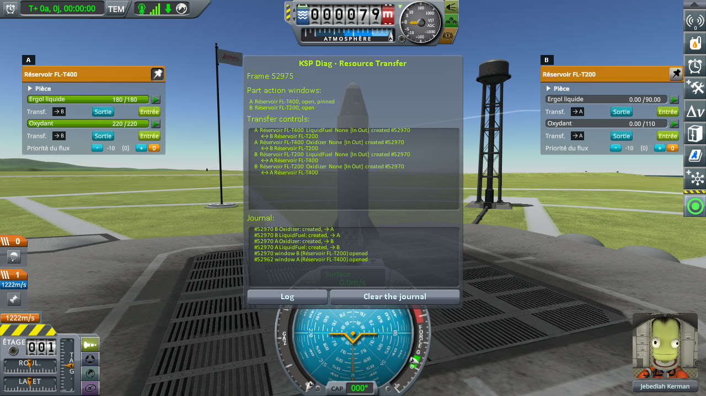
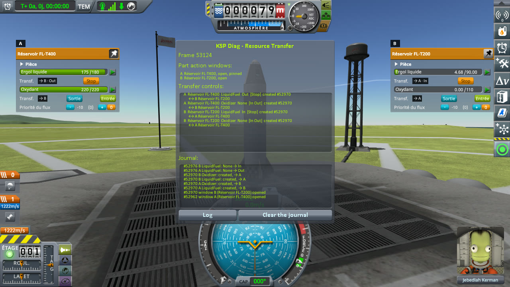
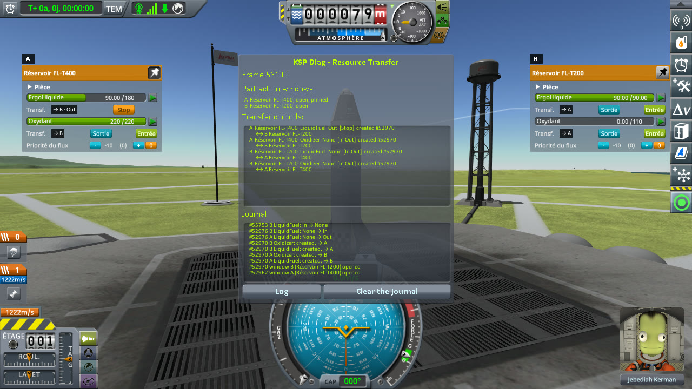
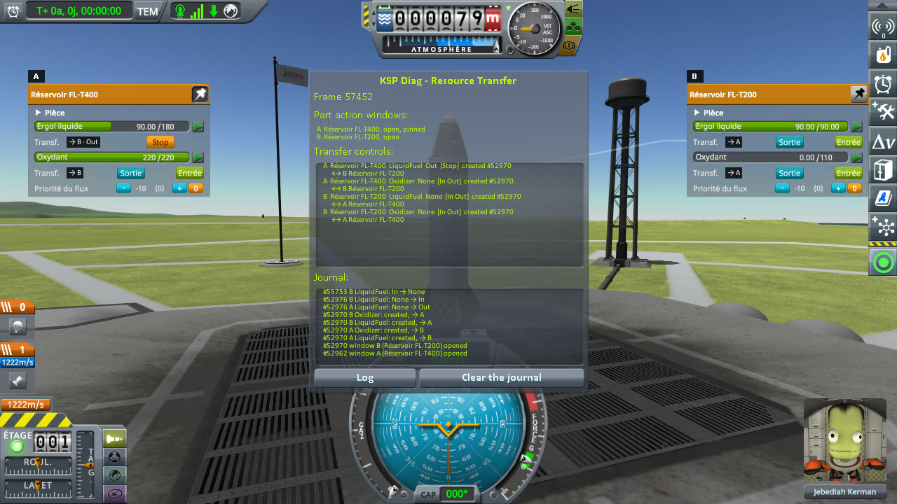
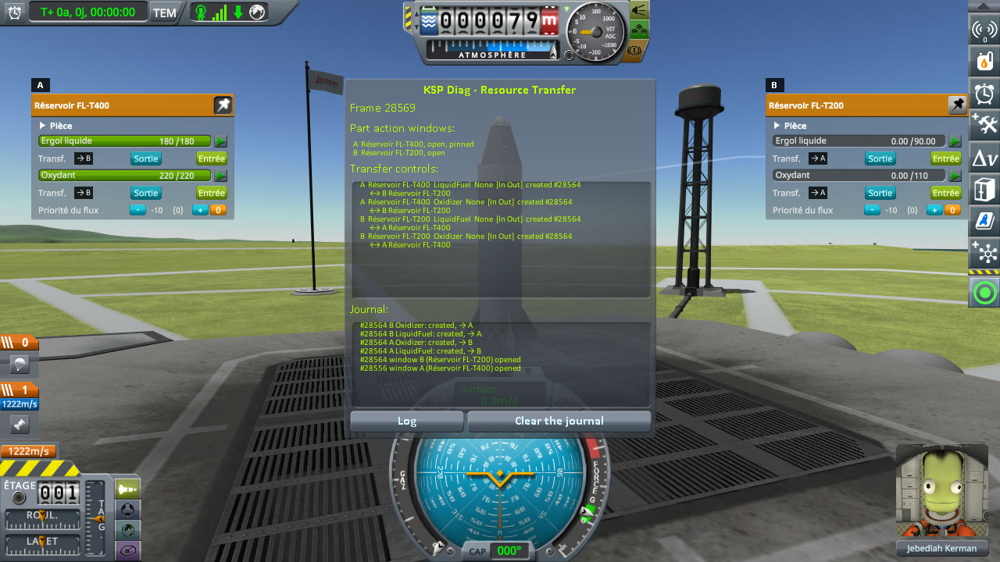
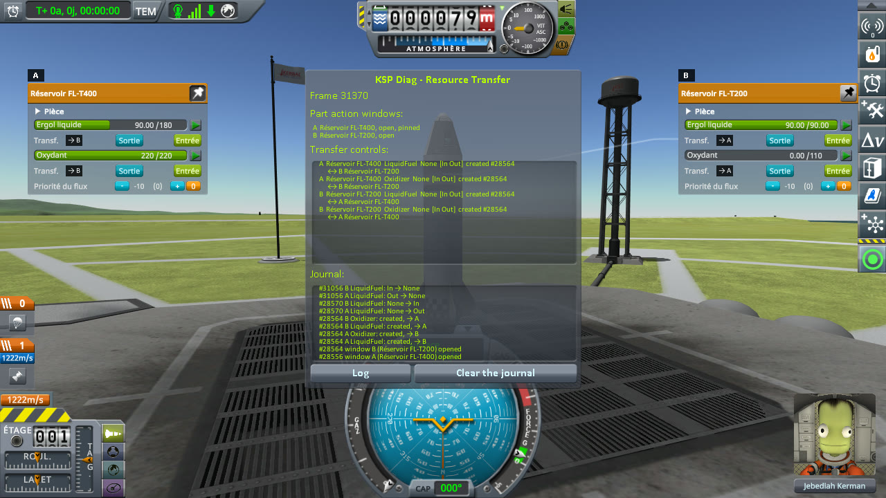
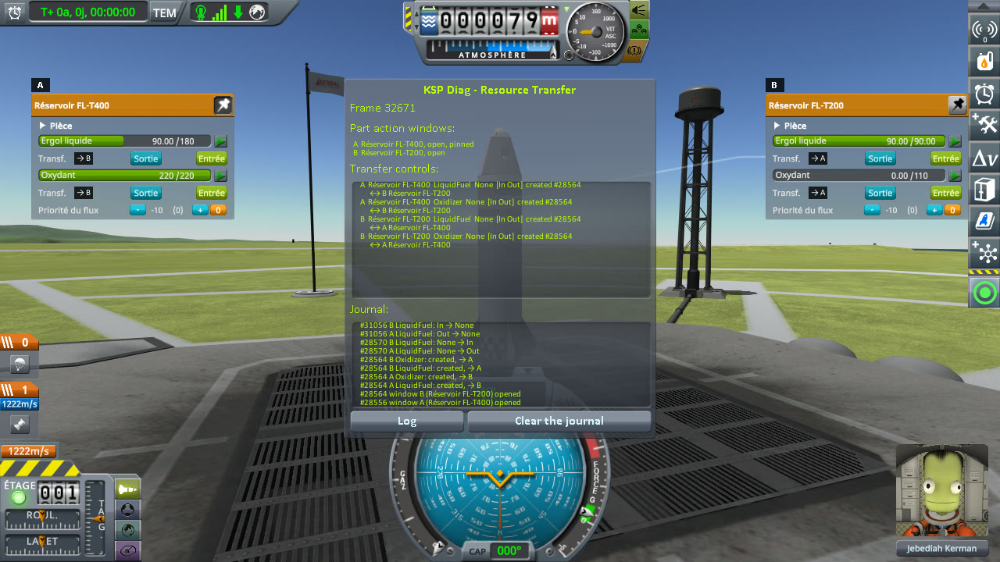

# Checking the culprit: filling a tank

Part of [Resource Transfer Fix](../README.md). A full tank fills an empty one through their part action
windows. Once the empty tank is full, does the full one go back to its In and Out buttons, or keep showing
Stop? Played without this mod, then with it.

## The install

KSP 1.12.5 with [KSP Community Fixes](https://github.com/KSPModdingLibs/KSPCommunityFixes) 1.41.1 (and the
Harmony and ModuleManager it needs), the base most players run, in French. *On stock* below means this
install. *With this mod* means this install with Resource Transfer Fix 0.1.0, both its patches on and its
log level set to `Debug` in `PluginData/settings.cfg`.
[KSP Diag - Resource Transfer](https://github.com/lhervier/KSP-Diag-ResourceTransfer) is installed in both,
to see how the windows pair their transfer controls: a letter above each window, and on each transfer row a
badge with the letters of the windows it is paired with, followed by `· Out` or `· In` while it sends or
takes. Its own window sits between the two part action windows.
[KSP-Util-MCPServer](https://github.com/lhervier/KSP-Util-MCPServer) is installed too, to play the protocol
by script.

The game is in French: in the windows, *Sortie* is Out, *Entrée* is In, *Ergol liquide* is liquid fuel and
*Oxydant* oxidizer.

## The protocol

The save is [transfer-kerbin.sfs](../diag/transfer-kerbin.sfs): a sandbox game with a rocket on the launch
pad. Under its pod, from top to bottom: an FL-T200 tank, empty; a Mk1 Liquid Fuel Fuselage, empty; an
FL-T400 tank, full, which plays the tanker; an engine. Copy the save into the folder of a sandbox game, and
load it.

1. Right-click the FL-T400 to open its part action window, and pin it.
2. Right-click the FL-T200 to open its window.
3. In the FL-T200's window, press In under its liquid fuel.
4. Wait until the FL-T200 holds 90 units of liquid fuel out of 90, then two seconds more, and note the
   buttons under the FL-T400's liquid fuel.
5. Wait ten seconds, and note them again.

**Played by a script.** [run-transfers.py](../diag/automation/run-transfers.py) plays it through
KSP-Util-MCPServer, and drags the FL-T400's window to the left of the screen and the FL-T200's to the
right, so that both show. Python 3 only, nothing to install: start KSP with KSP-Util-MCPServer, copy the
save into a sandbox game, open that game, then run
`python run-transfers.py --folder <your sandbox game> --protocol filling --out out`. It takes a screenshot at
each step: before step 3, one second after it, at step 4 and at step 5. With KSP Diag - Resource Transfer
installed, it also moves the Diag's window between the two others, empties its journal when the save is
loaded, and presses its *Log* button at the end.

## On stock

Read off the screenshots below, the liquid fuel of both tanks, the buttons under it and the badge of the
Diag on that row (the FL-T400's window is A, the FL-T200's B):

| Step | FL-T400 | its buttons | its badge | FL-T200 | its buttons | its badge |
|---|---|---|---|---|---|---|
| Before In | 180 / 180 | In, Out | → B | 0 / 90 | In, Out | → A |
| One second after In | 175 / 180 | Stop | → B · Out | 4.68 / 90 | Stop | → A · In |
| FL-T200 full | 90 / 180 | **Stop** | **→ B · Out** | 90 / 90 | In, Out | → A |
| Ten seconds later | 90 / 180 | **Stop** | **→ B · Out** | 90 / 90 | In, Out | → A |

The FL-T200 stopped when it was full; the FL-T400 kept sending, as far as its control is concerned, and
showing Stop, with 90 units left and nothing leaving it.

<p class="thumbs"><a href="../imgs/checking-the-culprit-filling/stock/1-before.jpg"></a> <a href="../imgs/checking-the-culprit-filling/stock/2-filling.jpg"></a> <a href="../imgs/checking-the-culprit-filling/stock/3-tank-full.jpg"></a> <a href="../imgs/checking-the-culprit-filling/stock/4-ten-seconds-later.jpg"></a></p>

<details>
<summary>The four screenshots, on stock</summary>

Before In:


One second after In:


The FL-T200 full:


Ten seconds later:


</details>

## With this mod

Read off the screenshots below:

| Step | FL-T400 | its buttons | its badge | FL-T200 | its buttons | its badge |
|---|---|---|---|---|---|---|
| Before In | 180 / 180 | In, Out | → B | 0 / 90 | In, Out | → A |
| One second after In | 175 / 180 | Stop | → B · Out | 4.59 / 90 | Stop | → A · In |
| FL-T200 full | 90 / 180 | **In, Out** | **→ B** | 90 / 90 | In, Out | → A |
| Ten seconds later | 90 / 180 | **In, Out** | **→ B** | 90 / 90 | In, Out | → A |

The transfer ran as on stock, and the FL-T400 went back to In and Out with the FL-T200.

<p class="thumbs"><a href="../imgs/checking-the-culprit-filling/fix/1-before.jpg"></a> <a href="../imgs/checking-the-culprit-filling/fix/2-filling.jpg"></a> <a href="../imgs/checking-the-culprit-filling/fix/3-tank-full.jpg"></a> <a href="../imgs/checking-the-culprit-filling/fix/4-ten-seconds-later.jpg"></a></p>

<details>
<summary>The four screenshots, with this mod</summary>

Before In:


One second after In:


The FL-T200 full:


Ten seconds later:


</details>

### What the log says

[`KSP.log`](../diag/fix/KSP.log) holds one line of the mod for this protocol, written when the FL-T200
became full:

```
[KSPFixResourceTransfer] [DEBUG] Stopped the LiquidFuel transfer out of fuelTank 1223746542: no tank takes from it any more
```

The stock log of the same protocol, [`KSP.log`](../diag/stock/KSP.log), has no line of Resource Transfer
Fix.

### What KSP Diag - Resource Transfer read

Its *Log*, pressed at the end of the protocol, writes its journal to `KSP.log`. The lines of the liquid
fuel transfer, on stock: the FL-T200's control (B) goes back to `None` when it is full, the FL-T400's (A)
never does.

```
[KSPDiagResourceTransfer] #52976 A LiquidFuel: None → Out
[KSPDiagResourceTransfer] #52976 B LiquidFuel: None → In
[KSPDiagResourceTransfer] #55753 B LiquidFuel: In → None
```

With this mod, both go back to `None` on the same frame:

```
[KSPDiagResourceTransfer] #28570 A LiquidFuel: None → Out
[KSPDiagResourceTransfer] #28570 B LiquidFuel: None → In
[KSPDiagResourceTransfer] #31056 A LiquidFuel: Out → None
[KSPDiagResourceTransfer] #31056 B LiquidFuel: In → None
```

## What the measurements say

On stock, a tank that has filled another one keeps showing Stop for as long as it is not empty, here with
half its liquid fuel left. With this mod, it shows In and Out again as soon as the tank it filled is full.
The transfer itself, the amounts moved and the buttons of the tank that was filled are the same in both.
