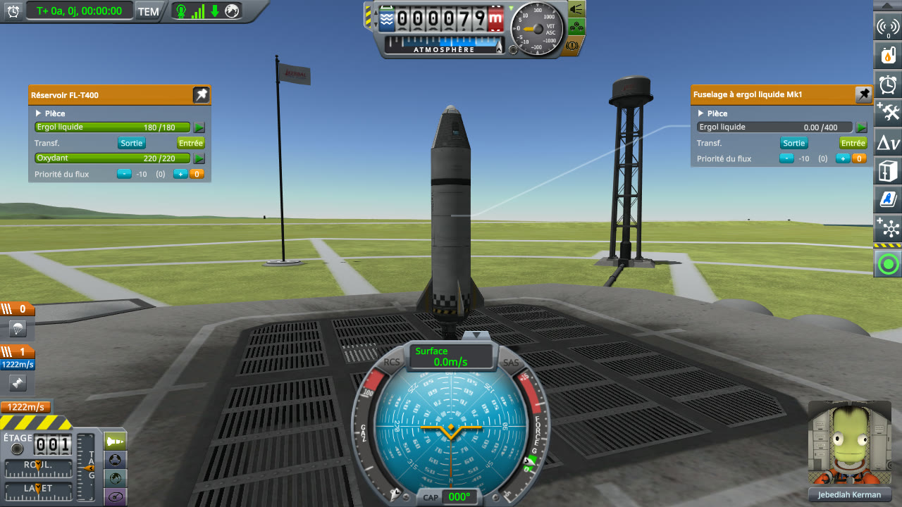
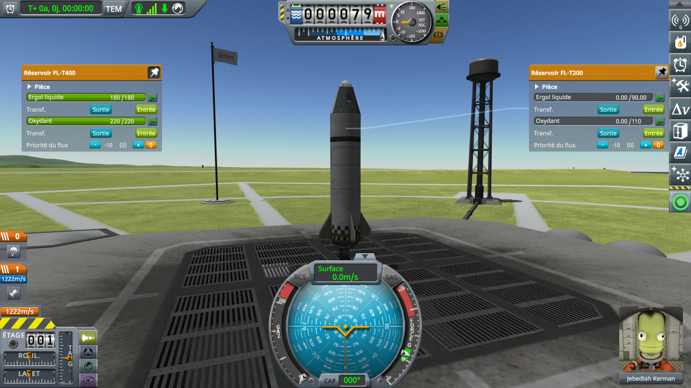
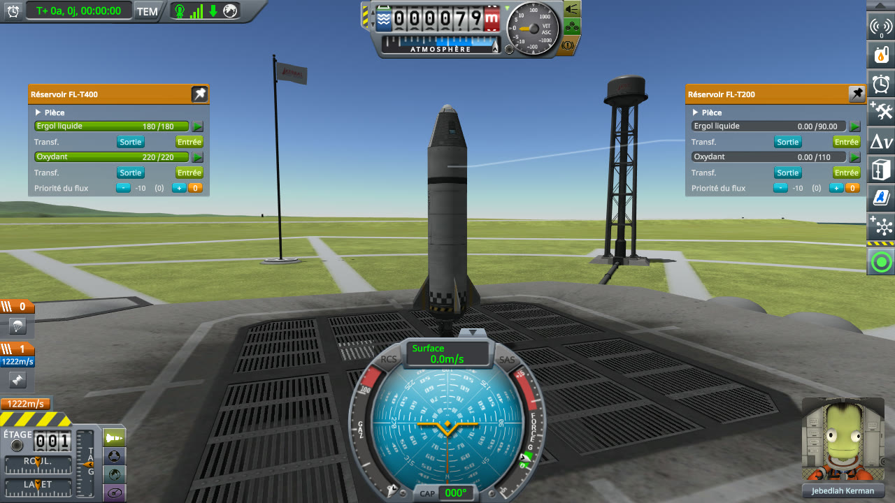
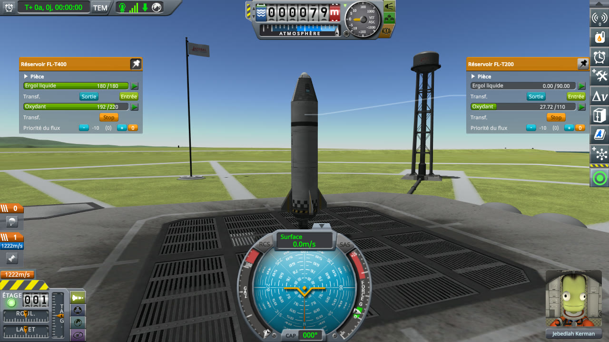

# Checking the culprit: a tank of liquid fuel only

Part of [Resource Transfer Fix](../README.md). With a tanker's window pinned, the window of a tank holding
liquid fuel only is opened, then the window of a tank of liquid fuel and oxidizer. Does In under the
oxidizer of the latter move any oxidizer? Played without this mod, then with it.

## The install

The same as for [filling a tank](checking-the-culprit-filling.md#the-install): KSP 1.12.5 with KSP
Community Fixes 1.41.1, in French (*Sortie* is Out, *Entrée* is In, *Ergol liquide* is liquid fuel,
*Oxydant* oxidizer), with Resource Transfer Fix 0.1.0 at `Debug` for *With this mod*.

## The protocol

The save is [transfer-kerbin.sfs](../diag/transfer-kerbin.sfs), the same rocket as for filling a tank: an
FL-T200 tank, empty; a Mk1 Liquid Fuel Fuselage, empty, which holds liquid fuel only; an FL-T400 tank,
full, the tanker. Copy the save into the folder of a sandbox game, and load it.

1. Right-click the FL-T400 to open its part action window, and pin it.
2. Right-click the Mk1 Liquid Fuel Fuselage to open its window.
3. Right-click the FL-T200: its window opens, and the fuselage's, not pinned, closes.
4. In the FL-T200's window, press In under its oxidizer.
5. Wait five seconds, and note the oxidizer of both tanks.

**Played by a script.** [run-transfers.py](../diag/automation/run-transfers.py), as for filling a tank,
with `--protocol fuel-only`. It drags the FL-T400's window to the left and the other window to the right,
and takes a screenshot after step 2, after step 3 and at step 5.

## On stock

Read off the screenshots below, the oxidizer of both tanks, and the buttons under it:

| Step | FL-T400 | its buttons | FL-T200 | its buttons |
|---|---|---|---|---|
| Fuselage open | 220 / 220 | none | — | — |
| FL-T200 open | 220 / 220 | In, Out | 0 / 110 | In, Out |
| Five seconds after In | 220 / 220 | In, Out | **0 / 110** | In, Out |

With the fuselage's window open, the oxidizer of the FL-T400 has no transfer buttons: the fuselage holds
none. Five seconds after In, no oxidizer had moved, and the FL-T200's buttons were In and Out again.

<p class="thumbs"><a href="../imgs/checking-the-culprit-fuel-only/stock/1-fuselage.jpg"></a> <a href="../imgs/checking-the-culprit-fuel-only/stock/2-tank.jpg"></a> <a href="../imgs/checking-the-culprit-fuel-only/stock/3-five-seconds-later.jpg"></a></p>

<details>
<summary>The three screenshots, on stock</summary>

The fuselage's window open:


The FL-T200's window open:


Five seconds after In:


</details>

## With this mod

Read off the screenshots below:

| Step | FL-T400 | its buttons | FL-T200 | its buttons |
|---|---|---|---|---|
| Fuselage open | 220 / 220 | none | — | — |
| FL-T200 open | 220 / 220 | In, Out | 0 / 110 | In, Out |
| Five seconds after In | 192 / 220 | Stop | **27.72 / 110** | Stop |

Five seconds after In, the FL-T200 held 27.72 units of oxidizer, taken from the FL-T400, and the transfer
was still running.

<p class="thumbs"><a href="../imgs/checking-the-culprit-fuel-only/fix/1-fuselage.jpg"></a> <a href="../imgs/checking-the-culprit-fuel-only/fix/2-tank.jpg"></a> <a href="../imgs/checking-the-culprit-fuel-only/fix/3-five-seconds-later.jpg"></a></p>

<details>
<summary>The three screenshots, with this mod</summary>

The fuselage's window open:


The FL-T200's window open:


Five seconds after In:


</details>

### What the log says

[`KSP.log`](../diag/fix/KSP.log) holds two lines of the mod for this protocol, written when the FL-T200's
window opened:

```
[KSPFixResourceTransfer] [DEBUG] Linked the LiquidFuel transfer of fuelTankSmall 649418999 with 1 tank(s) stock does not link it with here, 1 in all
[KSPFixResourceTransfer] [DEBUG] Linked the Oxidizer transfer of fuelTank 1223746542 with 1 tank(s) stock does not link it with here, 1 in all
```

The second line is the tanker's oxidizer control, created again one frame after the FL-T200's: the mod
paired it with the FL-T200's oxidizer control, which stock leaves unpaired (see
[How controls are paired](the-culprit.md#how-controls-are-paired)). The first is the FL-T200's liquid fuel
control, which the mod pairs on its creation and stock a moment later, when the window has finished opening.

## What the measurements say

On stock, after the window of a tank of liquid fuel only, In under the oxidizer of the next tank moves
nothing. With this mod, it moves oxidizer from the tanker as it does liquid fuel.
