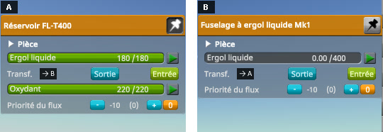
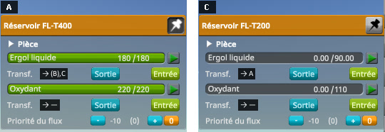

# The culprit: two mistakes in the way windows pair their transfers

Part of [Resource Transfer Fix](../README.md). How the part action windows of KSP 1.12.5 move a resource
from tank to tank, and the two places where they go wrong: when a transfer stops, and how its controls
are paired.

## The transfer controls

A part action window shows, under each resource of its part that can be moved, a transfer control: a
`UIPartActionResourceTransfer`, with an In button, an Out button and a Stop button. It shows only when at
least two windows are open and the part of every open window holds that resource
(`UIPartActionController.ShowTransfers`; with the advanced setting that makes transfers obey crossfeed,
every open part must also be reachable by crossfeed).

Each control keeps a list of targets: the controls of the same resource, on other parts, it is paired
with. It is in one of three states: `None`, `In` (it takes) or `Out` (it sends).

- **In** puts every shown target in `Out`, and the control itself in `In` (`OnBtnIn`).
- **Out** does the reverse: the control in `Out`, every target in `In` (`OnBtnOut`).
- **Stop** puts the control and every shown target back in `None` (`OnBtnStop`).

A control shows Stop while it is in `In` or `Out`, and In and Out while it is in `None`. The moving is done
by the controls that take: on every frame, `UpdateItem` of a control in `In` moves into its tank a share of
what each of its targets in `Out` holds.

## When a transfer stops

`UIPartActionResourceTransfer.UpdateItem` decides when a control goes back to `None`, and its two halves do
not look at the same thing (KSP 1.12.5, shortened):

```csharp
if (state == FlowState.In)
{
    bool stop = resource.amount >= resource.maxAmount || transferFraction == 0.0;
    if (!stop)
    {
        // Stop unless at least one shown target is not idle.
        stop = true;
        foreach (UIPartActionResourceTransfer target in targets)
            if (target.gameObject.activeInHierarchy && target.state != FlowState.None)
                stop = false;
    }
    if (stop) FlowStop();
    else { /* take a share from every shown target in Out */ }
}
else if (state == FlowState.Out)
{
    if (resource.amount <= 0.0) FlowStop();
}
```

**A tank that sends stops only when it is empty.** Nothing in the `Out` half looks at its targets. When the
tank it fills is full, that tank stops; the one that filled it stays in `Out`, and shows Stop, until it is
empty — which never comes, since no tank takes from it any more — or until Stop is pressed.

**A tank that takes keeps going while any target is busy.** The `In` half stops when its tank is full, or
when no shown target is in a state other than `None`: a target that takes too counts as much as one that
sends. Filled from a third tank, two tanks keep each other going once the third is empty and has stopped:
each sees the other in `In`, and both show Stop, although nothing reaches them. Both cases are played in
[Checking the culprit: filling a tank](checking-the-culprit-filling.md) and
[Checking several tanks](checking-several-tanks.md).

Pressing Stop on any tank of the transfer puts it and its targets back in `None`, and In and Out work again.

## How controls are paired

A control gets its targets from `UIPartActionController.SetupResourceTransfer`, called when the control is
created (`UIPartActionWindow.AddResourceTransferControl`) and, for every control of every window that holds
the same resource, when a window opens (`UIPartActionController.SelectPart`, through
`UIPartActionWindow.RefreshResourceTransferTargets`). It pairs the control, both ways, with the controls of
a list the controller keeps, then adds it to that list:

```csharp
// UIPartActionController.SetupResourceTransfer, KSP 1.12.5, shortened
foreach (UIPartActionResourceTransfer other in transfers)
{
    if (other.Resource.info.id != trans.Resource.info.id || other.Part == trans.Part) continue;
    if (!other.Targets.Contains(trans)) other.Targets.Add(trans);
    if (!trans.Targets.Contains(other)) trans.Targets.Add(other);
}
if (!transfers.Contains(trans)) transfers.Add(trans);
```

And `UIPartActionController.UpdateActiveWindows`, which updates every open window once per frame, starts
with `transfers.Clear()`. The list therefore only ever holds the controls created or refreshed since
`UpdateActiveWindows` last started. Two controls created or refreshed between the same two runs of it are
paired; a control created after a run has emptied the list, while the others were registered before, is
paired with none of them, and they not with it.

Every window updates its items in `UpdateActiveWindows`, right after the list is emptied, and a transfer
control that is no longer valid (`UIPartActionResourceTransfer.IsItemValid`: `ShowTransfers` false, say) is
destroyed, then created again on the first update where it is valid again. Most of the time, all the
controls of a resource are destroyed and created again together, and stay paired:

- **The window of a part without any of the resources** (an engine, a docking port) makes `ShowTransfers`
  false for all of them: every transfer control of every window goes. When that window closes, they all
  come back in the same update.
- **A window that opens** pairs its own controls through `SelectPart`, which also refreshes every window
  holding the resource of its first transfer control, and builds again (`CreatePartList`) the windows
  holding that resource without a transfer control for it.

The case that breaks is a part holding only some of the resources:

1. The tanker's window is pinned: an FL-T400, with liquid fuel and oxidizer.
2. The window of a Mk1 Liquid Fuel Fuselage opens. `ShowTransfers` is false for oxidizer only: at the
   next update of the windows, the tanker's oxidizer control is destroyed. Its liquid fuel control stays.

   

3. The window of an FL-T200, with liquid fuel and oxidizer, opens, which closes the fuselage's. Its two
   controls are created; `SelectPart` refreshes the windows holding its first resource, liquid fuel, and
   the two liquid fuel controls are paired. The tanker's window still holds a liquid fuel transfer control,
   so it is not built again.
4. The next run of `UpdateActiveWindows` (on the next frame, after a click of the mouse) empties the
   list, then the tanker's window creates its oxidizer control again. It is paired with what the list holds:
   nothing. The game's own windows do not show it: their oxidizer rows have their In and Out buttons, as
   when they are paired. The badges of KSP Diag - Resource Transfer do: `→ —` on both oxidizer rows.

   

*KSP 1.12.5 without this mod, with KSP Community Fixes, in French (Sortie is Out, Entrée is In, Ergol
liquide is liquid fuel, Oxydant oxidizer), with
[KSP Diag - Resource Transfer](https://github.com/lhervier/KSP-Diag-ResourceTransfer): its letters mark the
windows, A for the tanker's, B for the fuselage's, C for the FL-T200's, and its badge on each transfer row
gives the letters of the windows the row is paired with, in brackets when closed. The two windows cropped
from the screenshots of the [liquid-fuel-only protocol](checking-the-culprit-fuel-only.md#the-protocol),
after its steps 2 and 3: the tanker's on the left, pinned, the other one on the right.*

From then on, the oxidizer controls of the tanker and of the FL-T200 have no target. In makes the control
take from nobody: it goes to `In` with nothing to share between (`transferFraction` 0) and stops at the
next update of the windows, so the button seems to do nothing. Out makes it send to nobody: it goes to `Out` and shows Stop,
and nothing moves.


*The same install and protocol: the two windows at its step 5, five seconds after In was pressed under
the FL-T200's oxidizer.*

Closing the FL-T200's window leaves a single window open, which takes every transfer
control away (`ShowTransfers` wants two windows); opening it again brings them all back together, paired.
